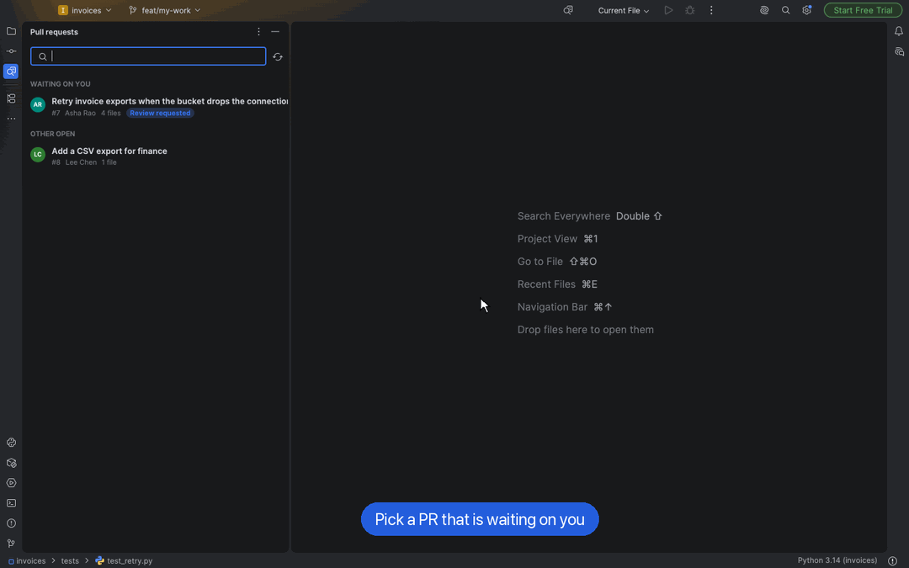
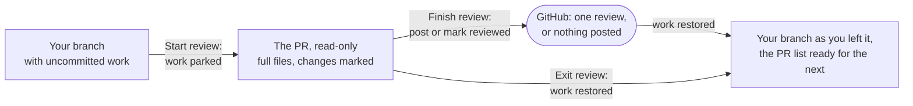

  

<h1 align="center">Review Lens</h1>

<b>Review pull requests inside your editor, with the whole codebase around them.</b>

  
  
  
  
  
   
  
  
  
  
  <!-- when VS Code ships, turn its badge green -->

## Why

A diff page shows the lines that changed. To judge them, you need the code around them: the caller, the test, the
config. Review Lens checks the PR out **in your editor**, so you review full files with every tool you already use.
Then it puts you back exactly where you were.

## How it works

- **Your work stays safe.** Uncommitted changes are parked and come back exactly on Exit.
- **Read the change in context.** Full files, changes marked in the gutter, a diff one click away.
- **Track progress.** ⭐ not viewed · ✅ viewed · 🔄 changed since viewed, synced with GitHub.
- **See who else uses what changed.** Each changed function shows the places outside the PR that use it, as code you can read and tick off. Python, Java and Kotlin.
- **See the whole conversation.** Everyone's GitHub comments sit under their lines, and the Comments tab lists them all. Reply, resolve, or edit your own comments in place.
- **Suggest the fix.** Comment on several lines, or propose replacement lines the author applies from GitHub.
- **Comment, then post once.** Comments, replies, summary and verdict go to GitHub as a single review, or mark it reviewed without posting.
- **See what's done.** Reviewed PRs turn green in the list with their verdict: ✓ Reviewed · approved.
- **Review only what's new.** Someone pushed after your review? The PR shows 🔄 New commits, and one click reviews only those.

## Get started

| Editor | Guide |
|---|---|
| **IntelliJ IDEA, PyCharm, WebStorm, GoLand** and the other JetBrains IDEs (2026.1+) | **[Install and use →](jetbrains/README.md)** |
| **VS Code**, Cursor, Windsurf | [Coming soon](vscode/README.md) |

You'll need **git**, and the **[GitHub CLI](https://cli.github.com/)** signed in (`gh auth login`).

## Your data

Review Lens keeps its state in your repository's `.git/review-lens/` folder, and your parked work in a named git
stash. It talks only to GitHub, through `gh`.

## Contributing

One product, one folder per editor, one shared contract. See [CONTRIBUTING.md](CONTRIBUTING.md).

## License

[Apache 2.0](LICENSE)
