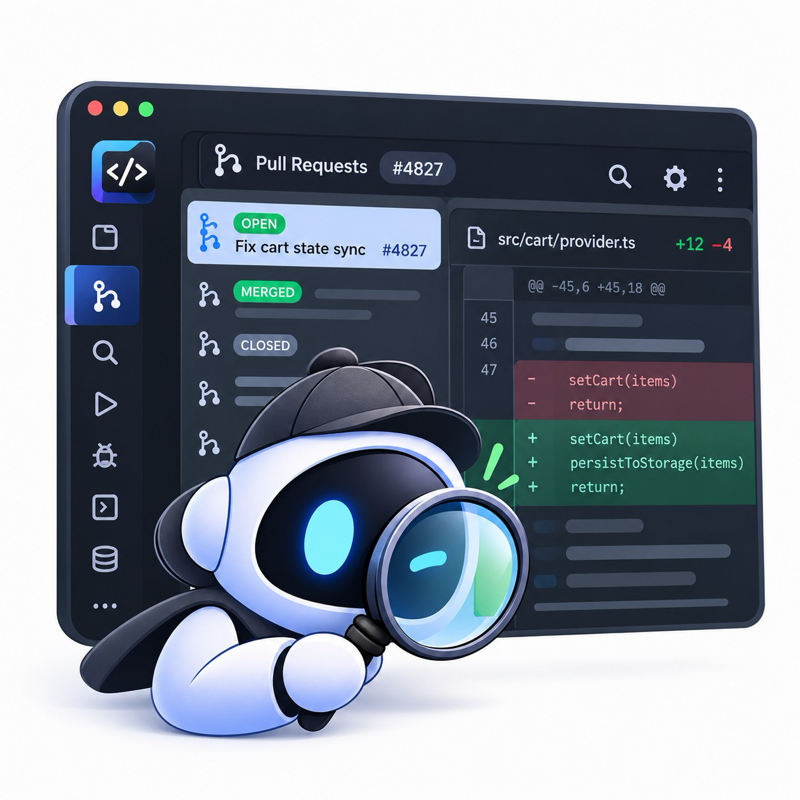
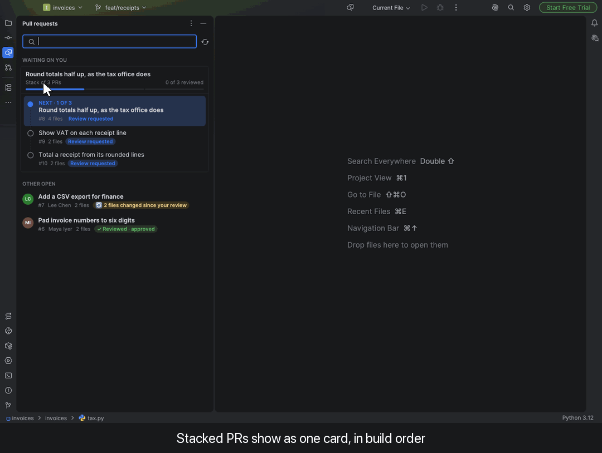
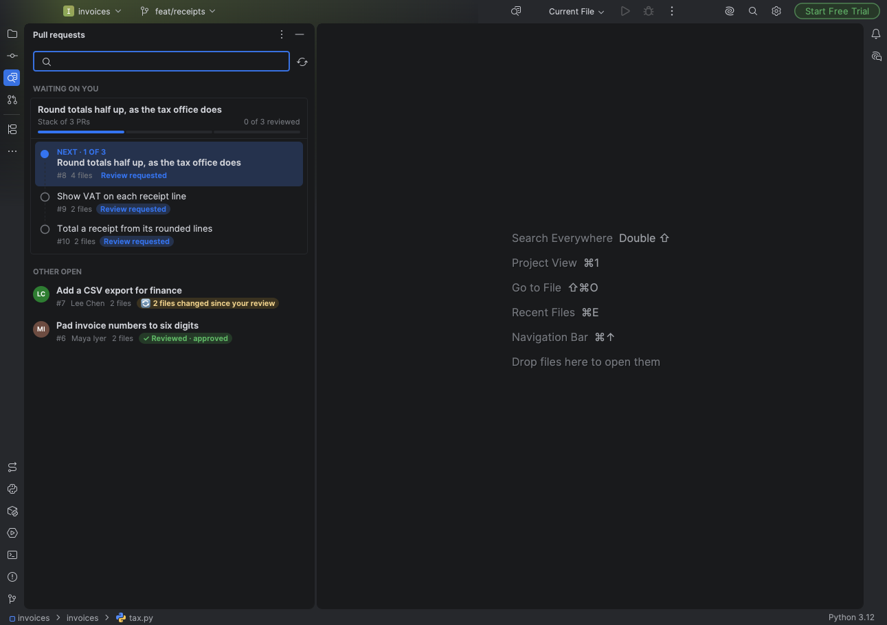
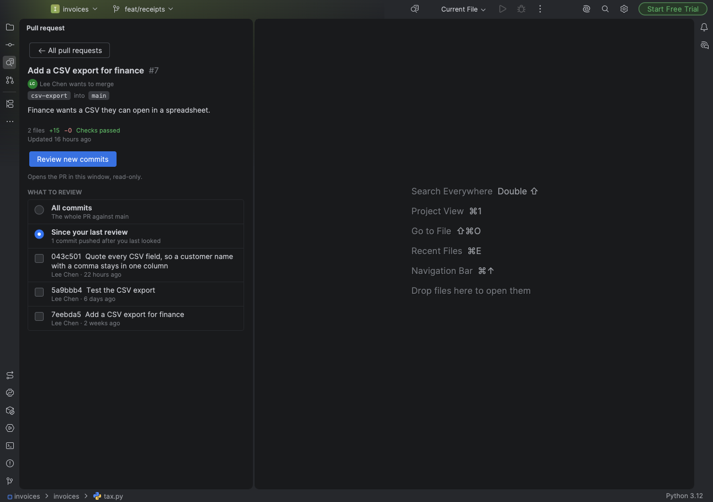
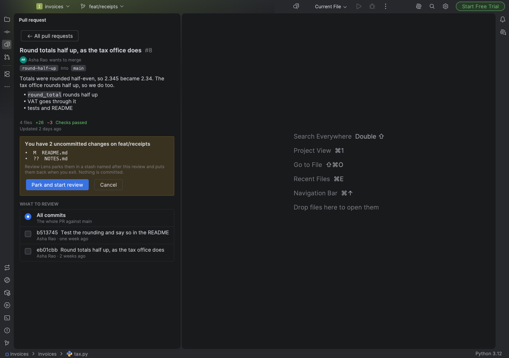
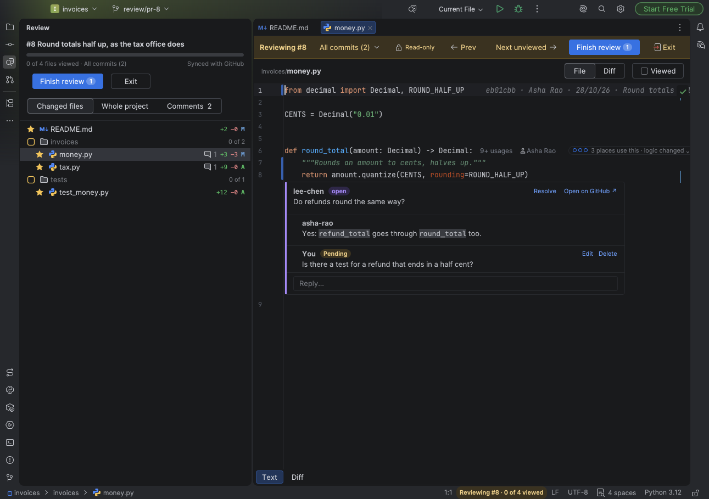
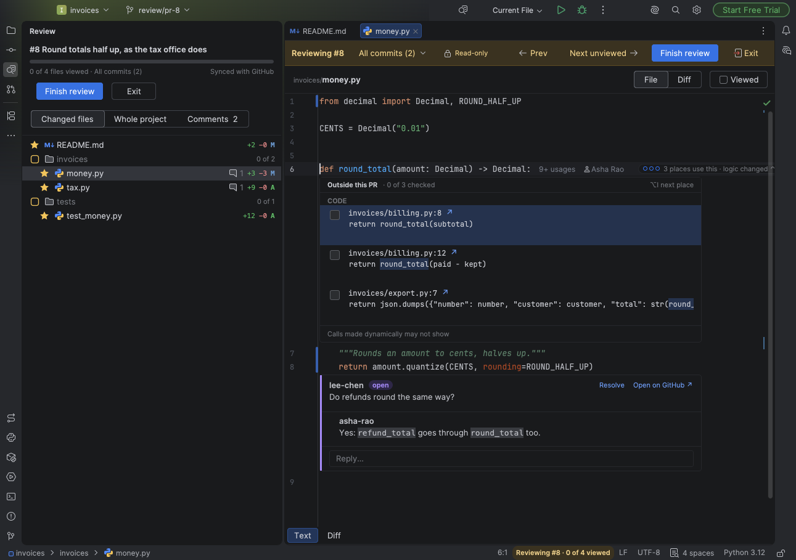
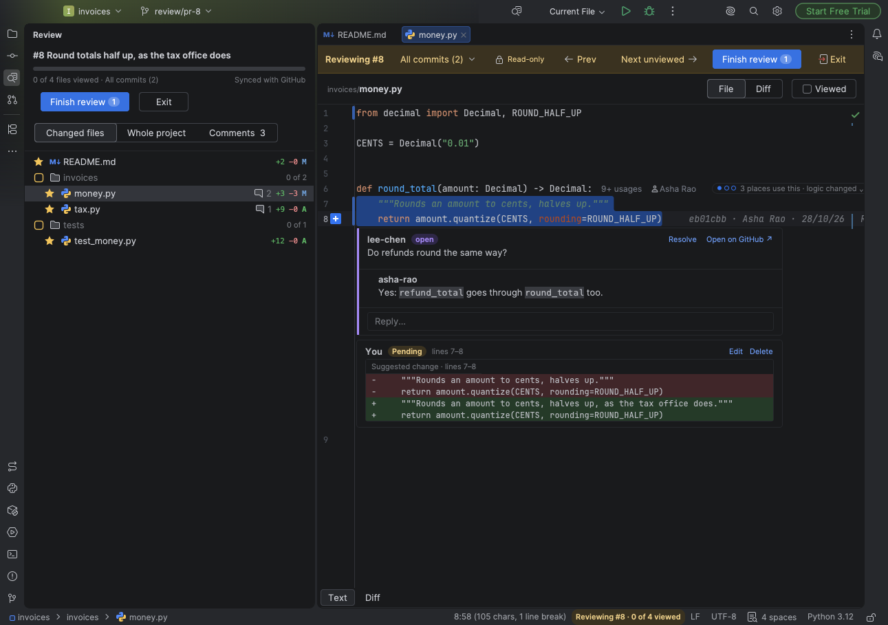
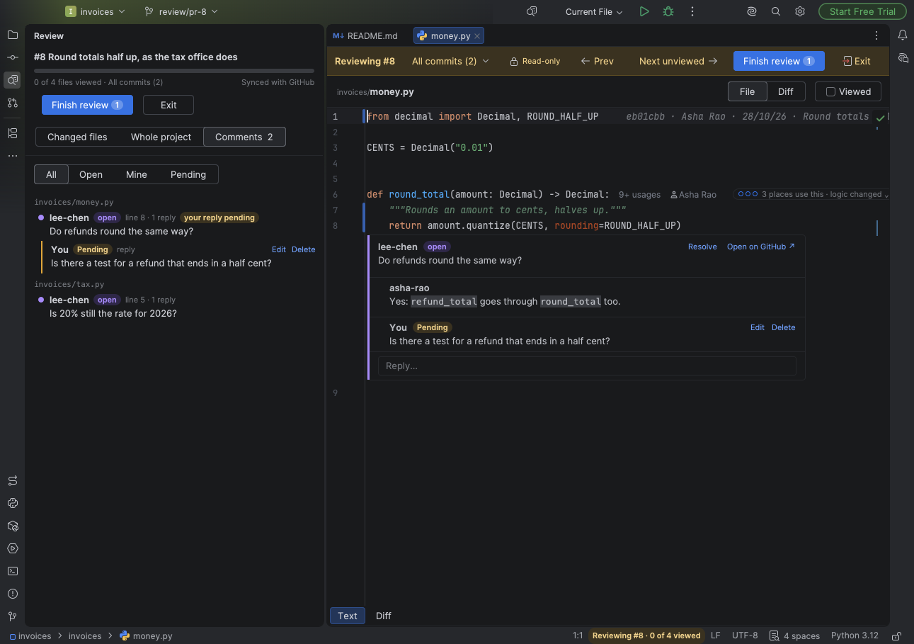
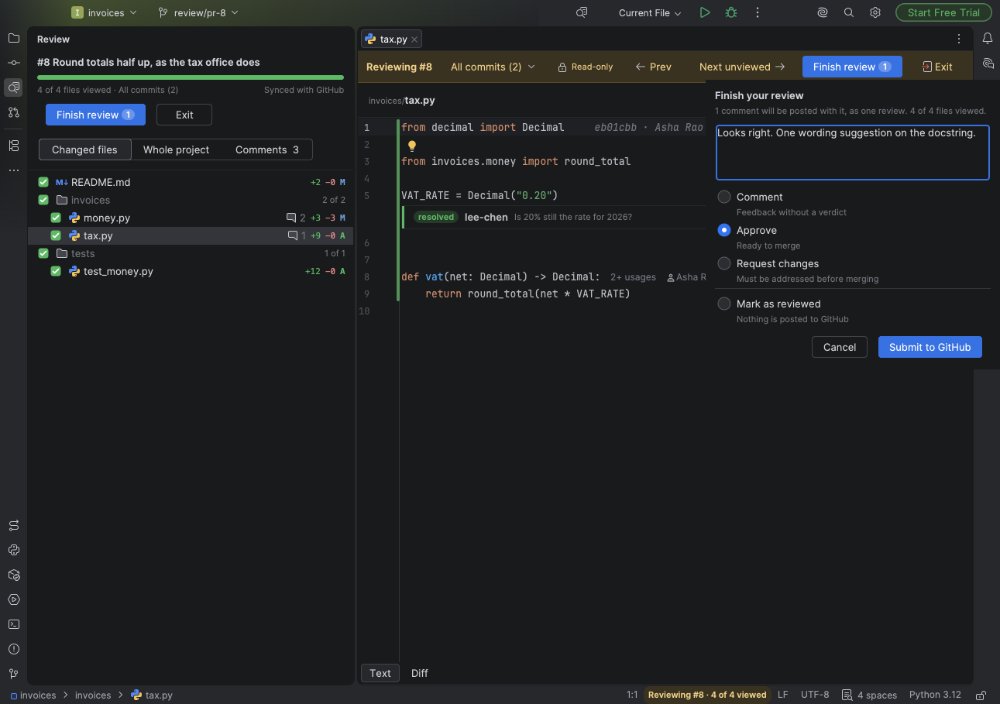

  

# Review Lens for JetBrains IDEs

Review GitHub pull requests in **IntelliJ IDEA, PyCharm, WebStorm, GoLand** or any other JetBrains IDE, version
**2026.1 or newer**. New to Review Lens? Start with the [main README](../README.md).

## Install

**Marketplace (recommended):** go to **Settings → Plugins → Marketplace**, search **Review Lens**, and click **Install**.
Or open [Review Lens on JetBrains Marketplace](https://plugins.jetbrains.com/plugin/35225-review-lens) and click **Install to IDE**.

<b>Or from the command line</b> (quit the IDE first)

| System | Command |
|---|---|
| macOS | `"/Applications/IntelliJ IDEA.app/Contents/MacOS/idea" installPlugins io.github.vatsarishabh22.reviewlens` |
| Windows | `& (Resolve-Path "C:\Program Files\JetBrains\IntelliJ IDEA*\bin\idea64.exe")[-1] installPlugins io.github.vatsarishabh22.reviewlens` |
| Linux | `./bin/idea.sh installPlugins io.github.vatsarishabh22.reviewlens`, from the folder you unpacked the IDE into |
| Toolbox | `idea installPlugins io.github.vatsarishabh22.reviewlens`, after **Toolbox → Settings → Tools → Generate shell scripts** |

For another IDE, swap the launcher: `pycharm`, `webstorm` or `goland` (`pycharm64.exe` on Windows, `pycharm.sh` on
Linux). On macOS, the Toolbox script returns at once and finishes the install a second or two later.

<b>Or from a download</b>

Get the zip from the newest [JetBrains release](https://github.com/vatsarishabh22/review-lens/releases?q=JetBrains&expanded=true).
Then go to **Settings → Plugins → ⚙ → Install Plugin from Disk…**, pick the zip, and restart.

**You'll need** git, and the [GitHub CLI](https://cli.github.com/) signed in (`gh auth login`). Without `gh`, you can
still review remote branches.

## Use it

**1. Pick a PR.** Open the **Review** tool window, or click **Review PR…** in the toolbar. PRs waiting on you come
first. Each PR says where your review stands: **✓ Reviewed · approved**, **Commented · 3 of 8 viewed**, **Resume · 2
drafts**. Once someone pushes, it says **🔄 2 files changed since your review**, counting only files you viewed that
really changed, so a rebase that changed none of them isn't news.

**Stacked PRs** (each built on the one before) show as one card in build order, headed **Stack of 4 PRs** and **2 of 4
reviewed**. Each PR is reviewed on top of the one under it (**on top of #12**), so you read only its own changes. Review
Lens finds the stack from git history, even when every PR targets main. If the PR under it changed since, it says **#12
changed under it**.

**2. Choose what to review.** Review all commits, tick the ones you want, or pick *Since your last review*. Then
click **Start review**. After new commits, *Since your last review* is already picked and the button reads **Review new
commits**.

**3. Your work is parked.** Any uncommitted changes are listed and stashed, then the PR opens read-only.

**4. Read, tick, comment.** The review bar sits above every file. Everyone's GitHub comments sit under the lines
they're on: open conversations in full, resolved ones folded to one line. To comment, hover a changed line, click **+**,
and write; `⌘↩` / `Ctrl+Enter` adds it, `Esc` cancels. To answer an open conversation, click **Reply…**. Comments and
replies stay drafts until you finish.

**See who else uses what changed.** Every function this scope changed gets a chip on its line, such as
**3 places use this · logic changed**. Click it to read each place's code right there, split into **Code** and
**Tests**, and tick each one off once you've checked it. **↗** opens a place in the editor, and `⌥I` / `Alt+I` jumps to
the next place left to check. A removed function that something still calls shows in a strip above line 1. No chip
means nothing outside the PR uses it. Works for Python, Java and Kotlin.

**Comment on several lines, or suggest the fix.** Select the lines, then click **+**. **Suggest a change** fills the
box with those lines for you to edit; the author applies your suggestion on GitHub in one click. Anyone's suggestions
show as removed and added lines.

**Resolve, edit, delete.** **Resolve** and **Unresolve** on a conversation, and **Edit** and **Delete** on your own
posted comments, go to GitHub at once: they don't wait for Finish.

The **Comments** tab, next to Changed files, lists every conversation and draft by file: **All**, **Open**, **Mine**,
**Pending**. Click one to jump to its line. Comments on lines that changed since are listed there too.

| Control | Shortcut (macOS / Windows, Linux) | Does |
|---|---|---|
| Scope ▾ | | Switch commits, or check GitHub for new ones |
| Next unviewed | `⌥N` / `Alt+N` | Go to the next file you haven't viewed |
| File / Diff | `⌥D` / `Alt+D` | The full file with changes marked, or a side-by-side diff |
| Viewed | `⌥R` / `Alt+R` | Tick the file, open the next one and close this tab (unless you opened it before the review, or its comment box holds text) |
| Next place to check | `⌥I` / `Alt+I` | Go to the next place the impact map hasn't ticked |

In **Changed files**, a folder's box ticks every file directly in it. Ticks go to GitHub as you make them; if GitHub is
slow, the panel says **Sending 2 to GitHub…** until they land.

**5. Finish review.** Click **Finish review** in the Review panel, or wait for Review Lens to offer it once every file
is viewed. Add a summary, pick **Comment**, **Approve** or **Request changes**, and click **Submit to GitHub**: your
comments and replies go to GitHub as one review. If someone resolved or deleted a conversation you replied to meanwhile,
the popup says so first. Comments you started on github.com and didn't submit go out with yours. Nothing to say? Pick
**Mark as reviewed**: nothing is posted, and any drafts are kept. Either way you're back on your branch with your work
restored, on the pull request list, where the PR shows its verdict in green. Click it to **Review again**. In a stack,
the message offers **Review #13 next →**, the next PR you haven't answered.

**6. Or exit partway.** **Exit**, in the Review panel, puts you back on your branch with your work restored, without
finishing. Come back any time: **Resume review** keeps your ticks and drafts.

## Troubleshooting

| You see | Do this |
|---|---|
| "Couldn't get pull requests from GitHub · showing branches" | `gh` is missing, signed out or offline. Run `gh auth status`. |
| "Back on *your-branch*" or "Finished #*N*": "your changes need a hand" | Your parked work conflicted with the branch. It's safe in the stash `review-lens: parked from …`. Resolve it, or run `git stash pop`. |
| "…Your comments are kept as drafts" | GitHub refused the review, and the message gives its reason (for example, a comment on a line that no longer exists). Fix that comment and finish again. Nothing was lost. |
| "You have a review in progress on GitHub…" in Finish review | Your unsubmitted review on github.com takes new comments only at the PR's latest push. Pick **All commits** in Scope ▾, or submit that review on GitHub first. |
| "GitHub takes a comment on several lines only inside one block of the diff" | Select lines within one changed block (the changed lines and the 3 around them), or comment on one line. |
| "Impact not available for *language* in this IDE" | The impact map reads Python, Java and Kotlin, where the IDE has that language (Python in PyCharm, or IntelliJ IDEA with the Python plugin). |
| The chip says **Many places** | The search took too long to list them. **Open Find Usages** shows them all. |
| Typing in a file does nothing | PR files are read-only during a review. Exit review to edit your own branch. |

Shortcuts can be changed in **Settings → Keymap** (search "Review Lens"). Developing the plugin? See
[CONTRIBUTING.md](CONTRIBUTING.md).
