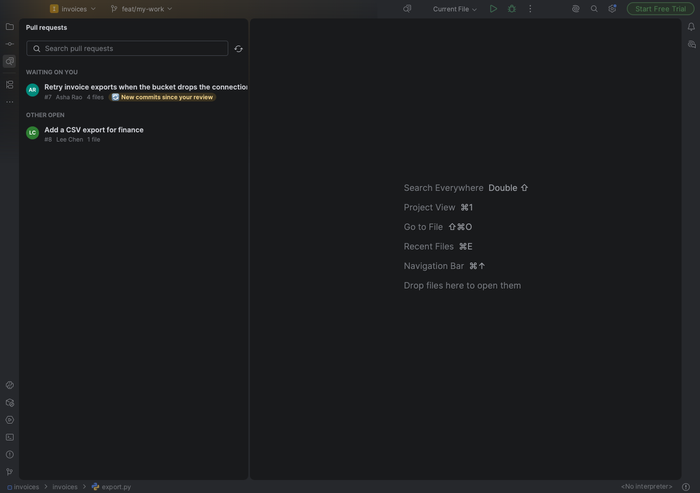
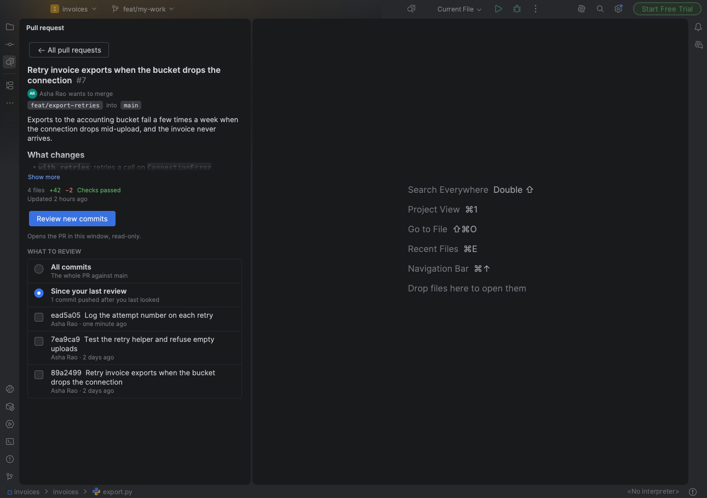
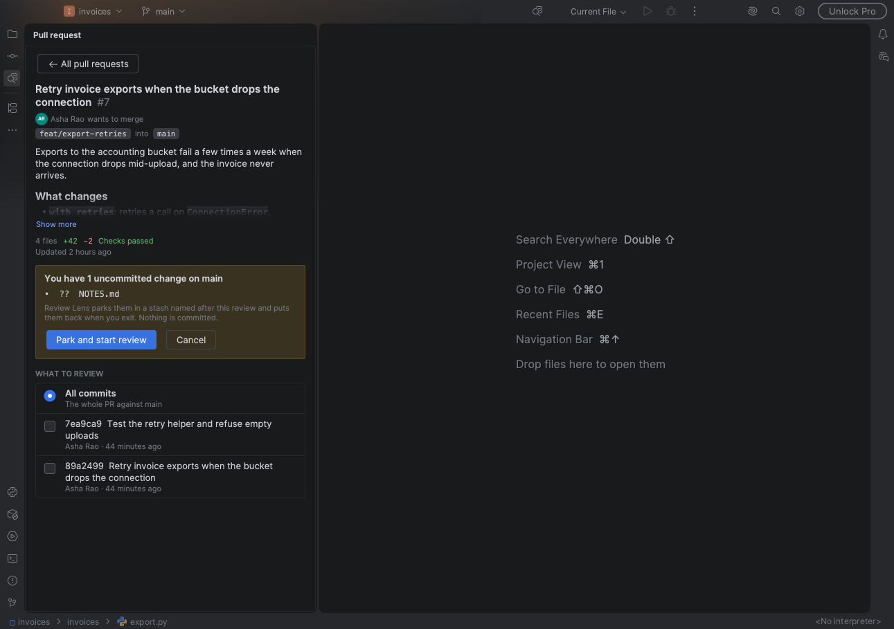
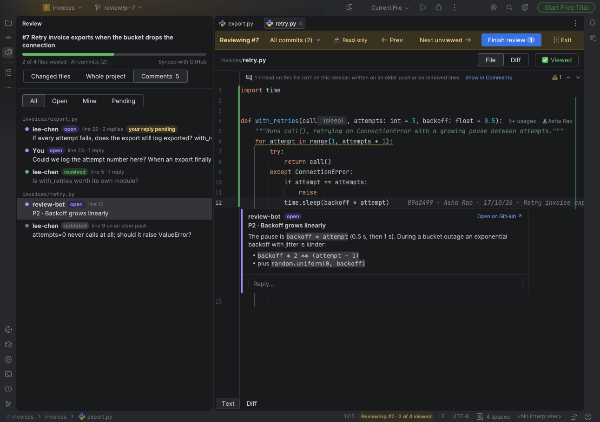
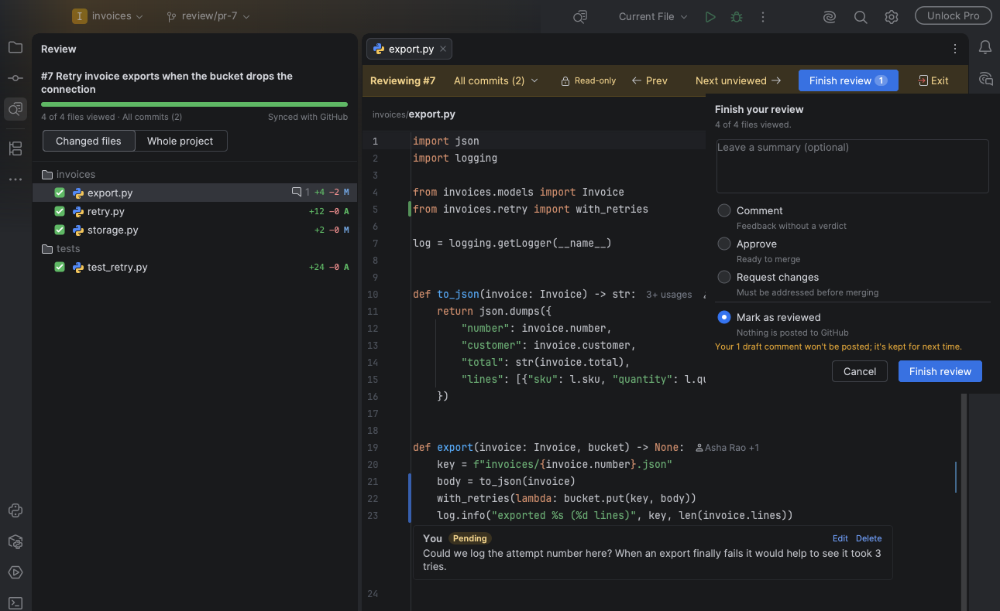

  

# Review Lens for JetBrains IDEs

Review GitHub pull requests in **IntelliJ IDEA, PyCharm, WebStorm, GoLand** or any other JetBrains IDE, version
**2026.1 or newer**. New to Review Lens? Start with the [main README](../README.md).

## Install

**Marketplace (recommended):** go to **Settings → Plugins → Marketplace**, search **Review Lens**, and click **Install**.
<!-- TODO after the Marketplace release: link the listing -->

<b>Or from the command line</b> (quit the IDE first)

| System | Command |
|---|---|
| macOS | `"/Applications/IntelliJ IDEA.app/Contents/MacOS/idea" installPlugins io.github.vatsarishabh22.reviewlens` |
| Windows | `& (Resolve-Path "C:\Program Files\JetBrains\IntelliJ IDEA*\bin\idea64.exe")[-1] installPlugins io.github.vatsarishabh22.reviewlens` |
| Linux | `./bin/idea.sh installPlugins io.github.vatsarishabh22.reviewlens`, from the folder you unpacked the IDE into |
| Toolbox | `idea installPlugins io.github.vatsarishabh22.reviewlens`, after **Toolbox → Settings → Tools → Generate shell scripts** |

For another IDE, swap the launcher: `pycharm`, `webstorm` or `goland` (`pycharm64.exe` on Windows, `pycharm.sh` on
Linux). On macOS, the Toolbox script returns at once and finishes the install a second or two later.

<b>Or from a download</b>

Get the zip from the newest [JetBrains release](https://github.com/vatsarishabh22/review-lens/releases?q=JetBrains&expanded=true).
Then go to **Settings → Plugins → ⚙ → Install Plugin from Disk…**, pick the zip, and restart.

**You'll need** git, and the [GitHub CLI](https://cli.github.com/) signed in (`gh auth login`). Without `gh`, you can
still review remote branches.

## Use it

**1. Pick a PR.** Open the **Review** tool window, or click **Review PR…** in the toolbar. PRs waiting on you come
first. A PR you've reviewed shows **✓ Reviewed**, or **🔄 New commits since your review** once someone pushes again.

**2. Choose what to review.** Review all commits, tick the ones you want, or pick *Since your last review*. Then
click **Start review**. After new commits, *Since your last review* is already picked and the button reads **Review new
commits**.

**3. Your work is parked.** Any uncommitted changes are listed and stashed, then the PR opens read-only.

**4. Read, tick, comment.** The review bar sits above every file. Everyone's GitHub comments sit under the lines
they're on: open conversations in full, resolved ones folded to one line. To comment, hover a changed line, click **+**,
and write; `⌘↩` / `Ctrl+Enter` adds it, `Esc` cancels. To answer an open conversation, click **Reply…**. Comments and
replies stay drafts until you finish.

The **Comments** tab, next to Changed files, lists every conversation and draft by file: **All**, **Open**, **Mine**,
**Pending**. Click one to jump to its line. Comments on lines that changed since are listed there too.

| Control | Shortcut (macOS / Windows, Linux) | Does |
|---|---|---|
| Scope ▾ | | Switch commits, or check GitHub for new ones |
| Next unviewed | `⌥N` / `Alt+N` | Go to the next file you haven't viewed |
| File / Diff | `⌥D` / `Alt+D` | The full file with changes marked, or a side-by-side diff |
| Viewed | `⌥R` / `Alt+R` | Tick the file and open the next one |

**5. Finish review.** Once every file is viewed, Review Lens offers **Finish review…**. Add a summary, pick **Comment**,
**Approve** or **Request changes**, and click **Submit to GitHub**: your comments and replies go to GitHub as one review. If someone resolved or deleted a conversation you replied to
meanwhile, the popup says so first. Nothing to
say? Pick **Mark as reviewed**: nothing is posted, and any drafts are kept. Either way you're back on your branch with
your work restored, on the pull request list, where the PR shows **✓ Reviewed** in green. Click it to **Review again**.

**6. Or exit partway.** **Exit** puts you back on your branch with your work restored, without finishing. Come back any
time: **Resume review** keeps your ticks and drafts.

## Troubleshooting

| You see | Do this |
|---|---|
| "Couldn't get pull requests from GitHub · showing branches" | `gh` is missing, signed out or offline. Run `gh auth status`. |
| "Back on *your-branch*" or "Finished #*N*": "your changes need a hand" | Your parked work conflicted with the branch. It's safe in the stash `review-lens: parked from …`. Resolve it, or run `git stash pop`. |
| "…Your comments are kept as drafts" | GitHub refused the review, and the message gives its reason (for example, a comment on a line that no longer exists). Fix that comment and finish again. Nothing was lost. |
| Finish review is refused, and GitHub's reason mentions a pending review | You started a review on github.com for this PR and didn't submit it. Submit or discard it there, then finish again. |
| Typing in a file does nothing | PR files are read-only during a review. Exit review to edit your own branch. |

Shortcuts can be changed in **Settings → Keymap** (search "Review Lens"). Developing the plugin? See
[CONTRIBUTING.md](CONTRIBUTING.md).
