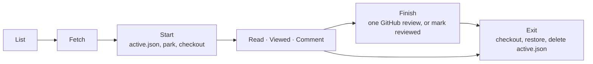

# The Review Lens contract

Every editor (`jetbrains/`, `vscode/`, …) implements this page. The UI is each editor's own; **what happens to the
repository is shared**. That's why a review started in one editor can be resumed or exited in another, on the same
checkout. The approved UX is `prototype/review-lens.html`.



## The flow

| Step | What happens | git / gh |
|---|---|---|
| List | Open PRs, the ones waiting on you first (your login is in their `reviewRequests`). Without `gh`, remote branches instead (and say so). | `gh auth status` · `gh pr list --state open --limit 100 --json number,title,headRefName,headRefOid,baseRefName,author,body,additions,deletions,changedFiles,updatedAt,reviewRequests` · `gh api user --jq .login` · without gh: `git branch -r --format=%(refname:lstrip=2)` and `git symbolic-ref --short refs/remotes/origin/HEAD` (default `origin/main`) |
| Fetch | A PR's head into a private ref, plus its base. A branch: fetch the remote. Then the commits since the merge base. | `git fetch --no-tags origin +pull/<n>/head:refs/review-lens/pr-<n> +refs/heads/<base>:refs/remotes/origin/<base>` · branch: `git fetch --no-tags origin` · `git merge-base <base> <head>` · `git log --format=%H%x09%an%x09%ct%x09%s <mergeBase>..<head>` |
| Scope | No pick, or every commit: `from = mergeBase`. A contiguous pick: `from = <oldest picked>^`, `to = <newest picked>`. "Since your last review": `from = seenHead`, `to = head`, offered only when `seenHead` is still in the PR's history and newer commits exist. Starting or re-scoping sets `seenHead = head`. | |
| Start | 1. Write `active.json` **first**, so a crash can always get back. 2. Park the work if the tree is dirty: tracked files (the editor's settings folder included, since teams commit files there and a PR can change them) and untracked files, except untracked files in the editor's settings folder (its scratch, rewritten constantly). 3. Check out the review branch **at the scope's end** (`range.to`), so the files on disk are exactly what the scope shows. On any failure: go back, restore, delete `active.json`. | `git status --porcelain` minus `?? .idea/…` lines · `git stash push --include-untracked -m "review-lens: parked from <ref> for <label>" -- . ":(exclude,literal)<each path of git ls-files --others --exclude-standard -- .idea>"` · `git checkout -B review/<key> <range.to>` |
| Read | Full files at `range.to`, changed lines marked against `range.from`. PR files are read-only. Blame on the caret line only when a commit in the scope last changed it. | `git diff --raw -z --no-abbrev -M <from> <to>` · `git diff --numstat -z -M <from> <to>` · `git show <rev>:<path>` · `git blame --porcelain <to> -- <path>` · `git rev-list <from>..<to>` |
| Viewed | Tick a file: `reviewed[path] = <its blob at range.to>`. A later change to the file un-ticks it (🔄). See [Viewed sync](#viewed-sync). | GraphQL `markFileAsViewed` / `unmarkFileAsViewed`, read with `pullRequest.files.viewerViewedState` |
| Comment | Drafts are kept in `drafts`, each pinned to the file version (`blob`) it was written on. A comment covers `line`, or `startLine`..`line` when lines were selected; a range must sit in one block of the diff (changed lines and the 3 around them), as GitHub requires. **Suggest a change** puts the covered lines into a ` ```suggestion ` block in the body, for the author to edit and commit on github.com; a suggestion in any comment shows as the covered lines removed and the block's lines added. A **reply** to an open thread is a draft with `replyTo` = the thread's id (its `path`, `line`, `blob` are the thread's; never a `startLine`); resolved threads take no new replies. | Finish: `startLine` + `startSide: RIGHT` on a range thread |
| Threads | Everyone's review threads on the PR, read when the review loads (not saved). A thread shows under its line only when GitHub anchors it to the version shown (`comments[0].commit == range.to`, `line` set, `diffSide` RIGHT): GitHub has already moved `line` to that commit. The rest (outdated, on the old side, or anchored to a newer push) are listed, not placed. Resolved threads fold to one line. Once threads are loaded, your posted drafts show as GitHub's threads instead. | GraphQL `pullRequest.reviewThreads{id path line startLine originalLine diffSide isResolved resolvedBy viewerCanResolve viewerCanUnresolve comments{id author body url commit viewerCanUpdate viewerCanDelete}}`, paginated |
| Resolve | Resolve on an open thread, Unresolve on a resolved one, shown only when GitHub allows this viewer (`viewerCanResolve` / `viewerCanUnresolve`). Sent at once, as on github.com: GitHub can't hold it in a pending review. The threads are then read again, so the card shows what GitHub answered; a refusal is said with GitHub's reason | `gh api graphql` `resolveReviewThread` / `unresolveReviewThread` (`threadId`) |
| Edit / delete posted | Your comments already on GitHub get Edit and Delete in their card, shown only when GitHub allows this viewer (`viewerCanUpdate` / `viewerCanDelete`). Both go to GitHub at once: a posted comment is public. Edit opens the same box in place; a refused edit reopens it with the text. Delete asks in the card first. Deleting a thread's first comment leaves its replies; deleting its last comment removes the thread (measured). The threads are then read again | `gh api graphql` `updatePullRequestReviewComment` (`pullRequestReviewCommentId`, `body`) / `deletePullRequestReviewComment` (`id`) |
| Finish | Opening it reloads the threads, so a thread resolved or deleted meanwhile is said before anything posts (a reply to a resolved thread still posts; one to a deleted thread waits as a draft). Then one review: summary, verdict, the pending comments **written on the file versions this scope shows** (`!posted && !replyTo && blob == the file's blob at range.to`; the others wait for their scope), and every pending reply whose thread still exists (when the threads could not be read, every reply is tried, and GitHub refusing one posts nothing). Sent drafts get `posted: true` and `verdict` = the event. GitHub keeps one pending review per person per PR, so a review you started on github.com is **adopted**: yours go into it and its comments post too (Finish says how many). What is added to a pending review lands on the PR's latest push, so when one exists and the scope ends earlier, comments can't join it: Submit is greyed with the reason (replies alone still can). If any step fails, only what Finish added is undone (a review it started is deleted; an adopted one loses just the comments Finish added): nothing is posted, nothing is marked sent, the review stays open. Or **Mark as reviewed**: nothing is posted, drafts stay pending, `verdict` unchanged. Every finish then does Exit, and the editor shows the PR list. | GraphQL, in order: `pullRequest{id headRefOid reviews(states:PENDING,first:1){nodes{id comments{totalCount}}}}` → no pending review: `addPullRequestReview{pullRequestId commitOID threads:[{path line side:RIGHT body}]}`; adopted: `addPullRequestReviewThread{pullRequestReviewId path line side:RIGHT body}` per comment → `addPullRequestReviewThreadReply{pullRequestReviewId pullRequestReviewThreadId body}` per reply → `submitPullRequestReview{event body}`; on failure `deletePullRequestReview` (started) or `deletePullRequestReviewComment` per added comment (adopted) |
| Exit | Tracked files written during the review (the editor rewriting its settings) that differ between the review commit and `originalRef` would block the checkout: only those are parked first as `review-lens: changed during review of <label>`, never applied, and the editor names them (a re-scope does the same before moving). Then back to `originalRef`, pop the stash by its message (`--index` first, plain pop as fallback; a conflict keeps the stash), delete `active.json`. `<key>.json` stays for next time. | `git diff --name-only HEAD` ∩ `git diff --name-only HEAD <originalRef>` · `git stash push -m "review-lens: changed during review of <label>" -- <those paths>` · `git checkout <originalRef>` · `git stash list --format=%gd%x09%gs` · `git stash pop --index stash@{n}` |

Badges: ⭐ not viewed · ✅ viewed at the current version · 🔄 changed since viewed.

In the list, a PR started before shows "🔄 New commits since your review" when its head on GitHub (`headRefOid`) is not
the head you last reviewed (`seenHead`, else `range.to`); opening it pre-selects "Since your last review" and the button
reads "Review new commits" ("Review again" when a force-push dropped `seenHead`, so "since" can't be offered). Otherwise "✓ Reviewed · approved / commented / changes requested" (from `verdict`, or
"N of N" without one) when every file of its saved scope is viewed at its current version, else "Resume · x of N viewed".

### Viewed sync

For a PR, GitHub's "Viewed" checkboxes and `reviewed` are one checklist:

1. On load, re-send every tick in `unsent` first (path → viewed). The ones GitHub accepts leave `unsent`. A path GitHub doesn't list among
   the PR's files (a scope file whose change the PR undoes, or one that came in with a merge from the base) has no Viewed box there: it
   leaves `unsent` unsent, keeps its local tick, and its later ticks stay local too.
2. Then fold in GitHub's state, except for paths that were in `unsent`, where this machine's answer wins:
   `VIEWED` → `reviewed[path] = blob` · `UNVIEWED` → remove the path · `DISMISSED` (changed since viewed) →
   `"dismissed"`, only when the path has no local entry or its entry equals the current blob.
3. A tick is saved locally at once and queued in `unsent`. GitHub's confirmation removes it, unless the reviewer has
   flipped it again since.

Own PR: the viewer's login equals the PR author's login. GitHub then only accepts a `COMMENT` review, and an empty
`COMMENT` or `REQUEST_CHANGES` (no summary and no comments) is refused, so the editor greys Submit out with the reason.

## The state

Everything lives in `.git/review-lens/`, outside the working tree, as JSON. The shapes are in
[`state.schema.json`](state.schema.json), and real examples are in [`fixtures/`](fixtures).

| File | Lifetime | Holds |
|---|---|---|
| `active.json` | From Start to Exit | The review in progress: target, head, `review/<key>` branch, the ref to go back to, the stash message (or `null`) |
| `<key>.json` | Kept across reviews | One PR's scope (`range`, `scopeLabel`), ticks (`reviewed`, `unsent`), `seenHead` for "since your last review", `drafts`, `checked`: the impact map's ticks per changed function, kept with a hash of its text ([impact.md](impact.md)), and `verdict`: the last event GitHub accepted (`COMMENT`, `APPROVE`, `REQUEST_CHANGES`), absent until one is posted |

`<key>` is `pr-<number>` for a PR, or `branch-<name>` for a branch, with anything outside `[A-Za-z0-9._-]` replaced
by `_`. The prefixes keep a branch named `active` or `pr-7` from overwriting another file.

### The Finish review payload

```json
{ "commit_id": "<range.to>", "event": "COMMENT | APPROVE | REQUEST_CHANGES", "body": "<summary, omitted when blank>",
  "comments": [{ "path": "app.py", "line": 22, "side": "RIGHT", "body": "…" }] }
```

## Conformance

Each editor's test suite loads every file in `fixtures/` through its **real** state reader, and must get every field
back. The VS Code suite also validates every fixture against `state.schema.json`. Change the shape here first, then
in every editor, in the same PR.

[`cases/`](cases) holds the rules every editor implements as shared cases: one file per rule,
`{"rule", "about", "cases": [{"name", "given", "expect"}]}`, the inputs real `git`/`gh` output where they read one.
Each editor runs every file through its **real** function (one small adapter per rule) and must give `expect`
exactly; `{"error": true}` means the input is refused, `null` that there is no answer. A file with no adapter, or an
adapter with no file, fails the run, so a new rule can't be skipped. `cases/github/` is GitHub's wire, run only by a
GitHub client. Change a rule here first, then in every editor, in the same PR.

| File | Rule |
|---|---|
| `scope` | Picked commits → `from`, `to`, the scope label |
| `since-last-review` | "Since your last review" range, or none |
| `viewed-merge`, `viewed-sync` | One checklist from this laptop's ticks and the host's Viewed answer; re-sending queued ticks |
| `finish-selection` | Which comments and replies Finish posts |
| `state-key` | `pr-<n>` / `branch-<name>` |
| `badge` | ⭐ / ✅ / 🔄 |
| `git-changes`, `git-blame` | `git diff --raw/--numstat -z`, `git blame --porcelain` |
| `suggestion` | A comment body's text and suggestion blocks |
| `github/viewed-answer`, `github/refusal`, `github/checks` | GitHub's Viewed answer, error body, checks rollup |

[`code-files.json`](code-files.json) is the one list of which files are code (GitHub Linguist's names and extensions),
for the impact map's "not available" line; every editor reads it as is, and the JetBrains suite checks each extension
sits in one row.
