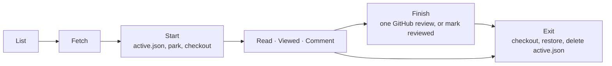

# The Review Lens contract

Every editor (`jetbrains/`, `vscode/`, …) implements this page. The UI is each editor's own; **what happens to the
repository is shared**. That's why a review started in one editor can be resumed or exited in another, on the same
checkout. The approved UX is `prototype/review-lens.html`.



## The flow

| Step | What happens | git / gh |
|---|---|---|
| List | Open PRs, the ones waiting on you first (your login is in their `reviewRequests`). Without `gh`, remote branches instead (and say so). | `gh auth status` · `gh pr list --state open --limit 100 --json number,title,headRefName,headRefOid,baseRefName,author,body,additions,deletions,changedFiles,updatedAt,reviewRequests` · `gh api user --jq .login` · without gh: `git branch -r --format=%(refname:lstrip=2)` and `git symbolic-ref --short refs/remotes/origin/HEAD` (default `origin/main`) |
| Fetch | A PR's head into a private ref, plus its base. A branch: fetch the remote. Then the commits since the merge base. | `git fetch --no-tags origin +pull/<n>/head:refs/review-lens/pr-<n> +refs/heads/<base>:refs/remotes/origin/<base>` · branch: `git fetch --no-tags origin` · `git merge-base <base> <head>` · `git log --format=%H%x09%an%x09%ct%x09%s <mergeBase>..<head>` |
| Scope | No pick, or every commit: `from = mergeBase`. A contiguous pick: `from = <oldest picked>^`, `to = <newest picked>`. "Since your last review": `from = seenHead`, `to = head`, offered only when `seenHead` is still in the PR's history and newer commits exist. Starting or re-scoping sets `seenHead = head`. | |
| Start | 1. Write `active.json` **first**, so a crash can always get back. 2. Park the work if the tree is dirty (the editor's own settings folder doesn't count). 3. Check out the review branch **at the scope's end** (`range.to`), so the files on disk are exactly what the scope shows. On any failure: go back, restore, delete `active.json`. | `git status --porcelain -- . ":(exclude,glob).ide[a]/**"` · `git stash push --include-untracked -m "review-lens: parked from <ref> for <label>" -- . ":(exclude,glob).ide[a]/**"` · `git checkout -B review/<key> <range.to>` |
| Read | Full files at `range.to`, changed lines marked against `range.from`. PR files are read-only. Blame on the caret line only when a commit in the scope last changed it. | `git diff --raw -z --no-abbrev -M <from> <to>` · `git diff --numstat -z -M <from> <to>` · `git show <rev>:<path>` · `git blame --porcelain <to> -- <path>` · `git rev-list <from>..<to>` |
| Viewed | Tick a file: `reviewed[path] = <its blob at range.to>`. A later change to the file un-ticks it (🔄). See [Viewed sync](#viewed-sync). | GraphQL `markFileAsViewed` / `unmarkFileAsViewed`, read with `pullRequest.files.viewerViewedState` |
| Comment | Drafts are kept in `drafts`, each pinned to the file version (`blob`) it was written on. A **reply** to an open thread is a draft with `replyTo` = the thread's id (its `path`, `line`, `blob` are the thread's); resolved threads take no new replies. | |
| Threads | Everyone's review threads on the PR, read when the review loads (not saved). A thread shows under its line only when GitHub anchors it to the version shown (`comments[0].commit == range.to`, `line` set, `diffSide` RIGHT): GitHub has already moved `line` to that commit. The rest (outdated, on the old side, or anchored to a newer push) are listed, not placed. Resolved threads fold to one line. Once threads are loaded, your posted drafts show as GitHub's threads instead. | GraphQL `pullRequest.reviewThreads{id path line originalLine diffSide isResolved resolvedBy comments{author body url commit}}`, paginated |
| Finish | Opening it reloads the threads, so a thread resolved or deleted meanwhile is said before anything posts (a reply to a resolved thread still posts; one to a deleted thread waits as a draft). Then one review: summary, verdict, the pending comments **written on the file versions this scope shows** (`!posted && !replyTo && blob == the file's blob at range.to`; the others wait for their scope), and every pending reply whose thread still exists (when the threads could not be read, every reply is tried, and GitHub refusing one posts nothing). Sent drafts get `posted: true` and `verdict` = the event. If any step fails, the pending review is deleted: nothing is posted, nothing is marked sent, the review stays open. Or **Mark as reviewed**: nothing is posted, drafts stay pending, `verdict` unchanged. Every finish then does Exit, and the editor shows the PR list. | GraphQL, in order: `addPullRequestReview{pullRequestId commitOID threads:[{path line side:RIGHT body}]}` → `addPullRequestReviewThreadReply{pullRequestReviewId pullRequestReviewThreadId body}` per reply → `submitPullRequestReview{event body}`; on failure `deletePullRequestReview` |
| Exit | Back to `originalRef`, pop the stash by its message (`--index` first, plain pop as fallback; a conflict keeps the stash), delete `active.json`. `<key>.json` stays for next time. | `git checkout <originalRef>` · `git stash list --format=%gd%x09%gs` · `git stash pop --index stash@{n}` |

Badges: ⭐ not viewed · ✅ viewed at the current version · 🔄 changed since viewed.

In the list, a PR started before shows "🔄 New commits since your review" when its head on GitHub (`headRefOid`) is not
the head you last reviewed (`seenHead`, else `range.to`); opening it pre-selects "Since your last review" and the button
reads "Review new commits" ("Review again" when a force-push dropped `seenHead`, so "since" can't be offered). Otherwise "✓ Reviewed · approved / commented / changes requested" (from `verdict`, or
"N of N" without one) when every file of its saved scope is viewed at its current version, else "Resume · x of N viewed".

### Viewed sync

For a PR, GitHub's "Viewed" checkboxes and `reviewed` are one checklist:

1. On load, re-send every tick in `unsent` first (path → viewed). The ones GitHub accepts leave `unsent`.
2. Then fold in GitHub's state, except for paths that were in `unsent`, where this machine's answer wins:
   `VIEWED` → `reviewed[path] = blob` · `UNVIEWED` → remove the path · `DISMISSED` (changed since viewed) →
   `"dismissed"`, only when the path has no local entry or its entry equals the current blob.
3. A tick is saved locally at once and queued in `unsent`. GitHub's confirmation removes it, unless the reviewer has
   flipped it again since.

Own PR: the viewer's login equals the PR author's login. GitHub then only accepts a `COMMENT` review, and an empty
`COMMENT` or `REQUEST_CHANGES` (no summary and no comments) is refused, so the editor greys Submit out with the reason.

## The state

Everything lives in `.git/review-lens/`, outside the working tree, as JSON. The shapes are in
[`state.schema.json`](state.schema.json), and real examples are in [`fixtures/`](fixtures).

| File | Lifetime | Holds |
|---|---|---|
| `active.json` | From Start to Exit | The review in progress: target, head, `review/<key>` branch, the ref to go back to, the stash message (or `null`) |
| `<key>.json` | Kept across reviews | One PR's scope (`range`, `scopeLabel`), ticks (`reviewed`, `unsent`), `seenHead` for "since your last review", `drafts`, and `verdict`: the last event GitHub accepted (`COMMENT`, `APPROVE`, `REQUEST_CHANGES`), absent until one is posted |

`<key>` is `pr-<number>` for a PR, or `branch-<name>` for a branch, with anything outside `[A-Za-z0-9._-]` replaced
by `_`. The prefixes keep a branch named `active` or `pr-7` from overwriting another file.

### The Finish review payload

```json
{ "commit_id": "<range.to>", "event": "COMMENT | APPROVE | REQUEST_CHANGES", "body": "<summary, omitted when blank>",
  "comments": [{ "path": "app.py", "line": 22, "side": "RIGHT", "body": "…" }] }
```

## Conformance

Each editor's test suite loads every file in `fixtures/` through its **real** state reader, and must get every field
back. The VS Code suite also validates every fixture against `state.schema.json`. Change the shape here first, then
in every editor, in the same PR.
