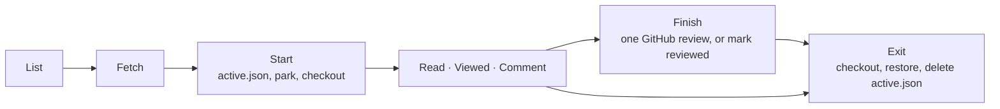

# The Review Lens contract

Every editor (`jetbrains/`, `vscode/`, …) implements this page. The UI is each editor's own; **what happens to the
repository is shared**. That's why a review started in one editor can be resumed or exited in another, on the same
checkout. The approved UX is `prototype/review-lens.html`.



## The flow

| Step | What happens | git / gh |
|---|---|---|
| List | Open PRs, the ones waiting on you first (your login is in their `reviewRequests`), [stacks](#stacks) grouped. Without `gh`, remote branches instead (and say so). | `gh auth status` · `gh pr list --state open --limit 100 --json number,title,headRefName,headRefOid,baseRefName,author,body,additions,deletions,changedFiles,updatedAt,reviewRequests,commits` · `gh api user --jq .login` · without gh: `git branch -r --format=%(refname:lstrip=2)` and `git symbolic-ref --short refs/remotes/origin/HEAD` (default `origin/main`) |
| Fetch | A PR's head into a private ref, plus its base, plus its stack parent's head when it has one. A branch: fetch the remote. Then the commits since the merge base, or since the parent's head. | `git fetch --no-tags origin +pull/<n>/head:refs/review-lens/pr-<n> +refs/heads/<base>:refs/remotes/origin/<base>` · branch: `git fetch --no-tags origin` · `git merge-base <base> <head>` · `git log --format=%H%x09%an%x09%ct%x09%s <mergeBase>..<head>` |
| Scope | No pick, or every commit: `from = mergeBase`, or for a PR in a stack the parent's head (see [Stacks](#stacks)). A contiguous pick: `from = <oldest picked>^`, `to = <newest picked>`. "Since your last review": `from = seenHead`, `to = head`, offered only when `seenHead` is still in the PR's history and newer commits exist. Starting or re-scoping sets `seenHead = head`. | |
| Start | 1. Write `active.json` **first**, so a crash can always get back. 2. Park the work if the tree is dirty: tracked files (the editor's settings folder included, since teams commit files there and a PR can change them) and untracked files, except untracked files in the editor's settings folder (its scratch, rewritten constantly). 3. Check out the review branch **at the scope's end** (`range.to`), so the files on disk are exactly what the scope shows. On any failure: go back, restore, delete `active.json`. | `git status --porcelain` minus `?? .idea/…` lines · `git stash push --include-untracked -m "review-lens: parked from <ref> for <label>" -- . ":(exclude,literal)<each path of git ls-files --others --exclude-standard -- .idea>"` · `git checkout -B review/<key> <range.to>` |
| Read | Full files at `range.to`, changed lines marked against `range.from`. PR files are read-only. Blame on the caret line only when a commit in the scope last changed it. | `git diff --raw -z --no-abbrev -M <from> <to>` · `git diff --numstat -z -M <from> <to>` · `git show <rev>:<path>` · `git blame --porcelain <to> -- <path>` · `git rev-list <from>..<to>` |
| Viewed | Tick a file: `reviewed[path] = <its blob at range.to>`. A later change to the file un-ticks it (🔄). A folder's tick is a tick of each file directly in it (or an untick of each, when all are ticked), sent as one batch. See [Viewed sync](#viewed-sync). | GraphQL `markFileAsViewed` / `unmarkFileAsViewed`, one aliased mutation per file in one call (3 files: 0.9 s vs 2.4 s one by one; 300 in one call: 2.5 s), read with `pullRequest.files.viewerViewedState` |
| Comment | Drafts are kept in `drafts`, each pinned to the file version (`blob`) it was written on. A comment covers `line`, or `startLine`..`line` when lines were selected; a range must sit in one block of the diff (changed lines and the 3 around them), as GitHub requires. **Suggest a change** puts the covered lines into a ` ```suggestion ` block in the body, for the author to edit and commit on github.com; a suggestion in any comment shows as the covered lines removed and the block's lines added. A **reply** to an open thread is a draft with `replyTo` = the thread's id (its `path`, `line`, `blob` are the thread's; never a `startLine`); resolved threads take no new replies. | Finish: `startLine` + `startSide: RIGHT` on a range thread |
| Threads | Everyone's review threads on the PR, read when the review loads (not saved). A thread shows under its line only when GitHub anchors it to the version shown (`comments[0].commit == range.to`, `line` set, `diffSide` RIGHT): GitHub has already moved `line` to that commit. The rest (outdated, on the old side, or anchored to a newer push) are listed, not placed. Resolved threads fold to one line. Once threads are loaded, your posted drafts show as GitHub's threads instead. | GraphQL `pullRequest.reviewThreads{id path line startLine originalLine diffSide isResolved resolvedBy viewerCanResolve viewerCanUnresolve comments{id author body url commit viewerCanUpdate viewerCanDelete}}`, paginated |
| Resolve | Resolve on an open thread, Unresolve on a resolved one, shown only when GitHub allows this viewer (`viewerCanResolve` / `viewerCanUnresolve`). Sent at once, as on github.com: GitHub can't hold it in a pending review. The threads are then read again, so the card shows what GitHub answered; a refusal is said with GitHub's reason | `gh api graphql` `resolveReviewThread` / `unresolveReviewThread` (`threadId`) |
| Edit / delete posted | Your comments already on GitHub get Edit and Delete in their card, shown only when GitHub allows this viewer (`viewerCanUpdate` / `viewerCanDelete`). Both go to GitHub at once: a posted comment is public. Edit opens the same box in place; a refused edit reopens it with the text. Delete asks in the card first. Deleting a thread's first comment leaves its replies; deleting its last comment removes the thread (measured). The threads are then read again | `gh api graphql` `updatePullRequestReviewComment` (`pullRequestReviewCommentId`, `body`) / `deletePullRequestReviewComment` (`id`) |
| Finish | Opening it reloads the threads, so a thread resolved or deleted meanwhile is said before anything posts (a reply to a resolved thread still posts; one to a deleted thread waits as a draft). Then one review: summary, verdict, the pending comments **written on the file versions this scope shows** (`!posted && !replyTo && blob == the file's blob at range.to`; the others wait for their scope), and every pending reply whose thread still exists (when the threads could not be read, every reply is tried, and GitHub refusing one posts nothing). Sent drafts get `posted: true` and `verdict` = the event. GitHub keeps one pending review per person per PR, so a review you started on github.com is **adopted**: yours go into it and its comments post too (Finish says how many). What is added to a pending review lands on the PR's latest push, so when one exists and the scope ends earlier, comments can't join it: Submit is greyed with the reason (replies alone still can). If any step fails, only what Finish added is undone (a review it started is deleted; an adopted one loses just the comments Finish added): nothing is posted, nothing is marked sent, the review stays open. Or **Mark as reviewed**, offered once every file of the scope is viewed (before that it would record nothing): nothing is posted, drafts stay pending, `verdict` unchanged. Every finish then does Exit, and the editor shows the PR list. | GraphQL, in order: `pullRequest{id headRefOid reviews(states:PENDING,first:1){nodes{id comments{totalCount}}}}` → no pending review: `addPullRequestReview{pullRequestId commitOID threads:[{path line side:RIGHT body}]}`; adopted: `addPullRequestReviewThread{pullRequestReviewId path line side:RIGHT body}` per comment → `addPullRequestReviewThreadReply{pullRequestReviewId pullRequestReviewThreadId body}` per reply → `submitPullRequestReview{event body}`; on failure `deletePullRequestReview` (started) or `deletePullRequestReviewComment` per added comment (adopted) |
| Exit | Tracked files written during the review (the editor rewriting its settings) that differ between the review commit and `originalRef` would block the checkout: only those are parked first as `review-lens: changed during review of <label>`, never applied, and the editor names them (a re-scope does the same before moving). Then back to `originalRef`, pop the stash by its message (`--index` first, plain pop as fallback; a conflict keeps the stash), delete `active.json`. `<key>.json` stays for next time. | `git diff --name-only HEAD` ∩ `git diff --name-only HEAD <originalRef>` · `git stash push -m "review-lens: changed during review of <label>" -- <those paths>` · `git checkout <originalRef>` · `git stash list --format=%gd%x09%gs` · `git stash pop --index stash@{n}` |

Start, a re-scope, Finish, Exit and the load an editor does when it opens on a review never run under one another (see
[Running at the same time](#running-at-the-same-time)).

Badges: ⭐ not viewed · ✅ viewed at the current version · 🔄 changed since viewed.

In the list, a PR you started (`<key>.json` holds a tick, a pending draft or a `verdict`) says where you are, counted
in its saved scope (x of N files viewed at their current version); a PR you only opened says nothing. In order:

| State | Says | Button |
|---|---|---|
| Its head on GitHub (`headRefOid`) moved past the head you last reviewed (`seenHead`, else `range.to`), and the host marks files you viewed as changed since | 🔄 *k* files changed since your review; 🔄 New commits since your review until the host answers, without one, or for a verdict with nothing ticked | Review new commits (pre-selects "Since your last review"); Review again when a force-push dropped `seenHead` |
| `verdict` APPROVE / REQUEST_CHANGES (final on GitHub, whatever was read) | ✓ Approved · x of N viewed / ✓ Changes requested · x of N viewed; ✓ Reviewed · approved once x = N | Review again |
| Every file viewed | ✓ Reviewed · commented, or · N of N without a verdict | Review again |
| `verdict` COMMENT | Commented · x of N viewed | Resume review |
| A tick | Resume · x of N viewed | Resume review |
| Only pending drafts | Resume · *d* drafts | Resume review |

"Review requested" shows beside any of these while your login is in `reviewRequests`. A moved head whose files the host
doesn't mark changed (a rebase that changed none of them) is not news: GitHub keeps a file's Viewed through a rebase or an
amend that leaves its content alone, and un-marks it (DISMISSED) once its content changes, even if a later push puts the
viewed content back (measured). The list shows at once; *k* is asked of the host afterwards, for every moved PR with files
viewed at the version you last reviewed, all at once (GitHub: `pullRequest.files.viewerViewedState`), counting those
files it marks DISMISSED, and the pill changes when it answers. The host can't say while it lacks your ticks (some
still in `unsent`, or none of them on it: another login), nor that nothing changed when the PR now has files outside
your review (a new file, a narrowed scope, a stacked PR's parent): the pill stays "New commits". The host is asked
with a 20 s limit, and a failed ask is quiet.

### Stacks

A stack is PRs built branch on branch. The host doesn't always know: teams often point every PR at `main`. Review Lens
works the stack out from one exact fact, and writes down what it saw so it never has to guess later.

**Stacked the host's way.** When this PR's `baseRefName` is another open PR's head branch, that PR is its parent, before
anything else: the host says so itself. Only a PR from this repository counts (`isCrossRepository` false): a PR's base
branch lives here, so a fork's same-named branch (a contributor's `main`) is never anyone's parent. Git already compares from where the PR left that branch, so the PR compares with
its base as any PR does: it is grouped, says "on top of #*p*", is never said to have a moved parent, and the note keeps
that (`onBranch`), so a later look that can't ask the host still knows.

**The exact fact.** A PR is built on another open PR when that PR's head is in this PR's commits (`commits[].oid`). A
PR at this PR's own head is never its parent (a PR opened before its first push, or one branch sent to two bases): each
would hold the other's head, and the PR would show nothing to review.
When several are (a whole stack below it), the parent is the closest: the one whose head sits latest in this PR's
commits. Positions in this PR's own list, never the other PRs' list lengths: the host sends each PR's last 100 commits,
so in a deep stack every list is 100 long.

**The note.** Each list writes what it saw to `stacks.json` (`parents`): "#13 sits on #12, seen at #12's head `abc`".
On the next list, the note speaks only for a parent that moved; every other time the exact fact decides, so a PR
rebuilt on a closer parent is seen at once. A PR the exact fact finds above the noted one (its head sits later in this
PR's commits than the head the note saw) is closer, and wins:

| The note says #13 sits on #12 at `abc`, and now | #13's parent |
|---|---|
| #12's head is still `abc` | #12, built on it as it is |
| #12's head moved, and #13 holds its new head (#13 was rebuilt on it) | #12, built on it; the note takes the new head |
| #12's head moved, and #13 still holds `abc` (pushed to, #13 not rebuilt) | #12, **moved**: "#12 changed under it" |
| #12 is no longer open (merged or closed) | The note is dropped; the exact fact decides again (a merged parent's changes are in the base) |
| #13 no longer holds `abc` (it was rebuilt somewhere else) | The note is dropped; the exact fact decides again |

With no note, the exact fact decides and is written down; with neither, the PR has no parent. Notes of PRs no longer
open are dropped at each list. When the host doesn't say a PR's commits (its lookup failed), neither rule can be
checked: the PR finds no parent from its commits this time (one based on another PR's branch still shows it), and its
note is kept as it is for the next list, never read as "no parent".

A wider grouping, said rather than guessed: a long-lived branch with its own PR (a release PR `develop` → `main`) is the
parent of every PR into that branch, so they all show as one card on top of it, the release PR first. Every diff is
right (each PR compares with `develop`); only the grouping is wider than a stack. Telling a release branch from a
stack's would take a guess, and Review Lens doesn't guess.

The one gap: a stack Review Lens never saw whole. When #12 was pushed to before any list saw #13 on it, there is no
note, and the exact fact finds the next PR down, #11. #13 then sits on #11 and also shows the changes of the #12 it was
built on: true, never hidden, only wider than its own.

**Comparing.** A PR built on its parent compares from the parent's head: it shows only what it adds, and its commit
list, file count and changes are its own. That is exact when the PR took no newer base than its parent; when it merged a
newer base, `from` is the merge of the parent's head with that base (`git merge-tree --write-tree`), and when that merge
conflicts or isn't available, the PR compares with its base as before and says so. That merge is a commit on no branch,
kept from git's cleanup under `refs/review-lens/<key>-base` and made again only when the parent's head or the base moves.
Starting or re-scoping a review keeps its own `range.from` under `refs/review-lens/<key>-from` too, so the saved range
still resolves weeks later, whatever was made since. A PR whose parent moved compares with its base and says
"#*parent* changed under it". The parent's head at the last load is saved (`parentHead` in `<key>.json`, replaced on
every load), so the review bar's scope menu works out the same starting point without asking the host. "Check for new
commits" asks the host for the stack again, and for the PR's base branch as it is now (a merged parent's branch is
gone, and the host has moved the PR onto the parent's base); when it can't, it uses the parent the last list wrote down, and a PR that
can only compare with its base says why in a balloon.

In the list, a stacked PR counts its own files, not the host's count against the base: what it adds on top of its
parent's head. The list shows at once with the counts kept in `stacks.json`, asks the host for the missing ones
(GitHub: `gh api repos/{owner}/{repo}/compare/<parent head>...<head>`, all at once), and shows them as they come. The
bottom PR, a PR whose parent moved and a PR stacked the host's way compare with their base, so the host's own count is
theirs. A PR that merged a newer base than its parent counts that base's changes too in the list (the host has no merge
of the two to count from); its detail and its review count exactly what it adds. While its detail loads, it shows
the list's own count without lines (none while the list has none), never the host's count against the base.

The list shows a stack as one card, named by its bottom PR's title (always there, whatever the team calls its branches),
in **Waiting on you** when any PR in it asks for your review (else Other open): one PR asking brings the rest along, so
the order stays whole. Its header stays put: the name on its own line, "Stack of n PRs", "r of n reviewed" and one bar segment per PR (green
reviewed, blue next). Below it every PR sits on a rail in build order, bottom first: ✓ reviewed, the **next** one (the
lowest not reviewed) highlighted with "Next · k of n", the rest hollow, and "#*p* changed under it" on a PR whose parent
moved. Two PRs built on the same parent follow one another on the rail, a PR's children after it by number; a row whose
parent isn't the row above it says "on #*p*". The rows scroll inside the card past a fixed height (about seven rows),
opened scrolled to the next one, so a long stack never pushes the other PRs out of the list; what scrolled out is
counted over the card's top and bottom edges ("↑ 10 reviewed above", "↓ 2 more below"), a row more than half hidden
counting as out.

Finish on a stacked PR offers the next one in its balloon ("Review #*n* next →"): the card's next PR, leaving out the one
just finished and every PR the reviewer already answered with a verdict (a Commented one isn't done, yet offering it again
would send two Commented PRs round in circles), unless it has commits since; so it can sit below the one finished. The
balloon waits for the list that ending the review loads (about a second), so the link comes from today's list, even
after a restart that never showed it; a list that fails, or takes over 5 s, gives the balloon without the link, never no
balloon. The link opens that PR's detail, never its review: Start review there says what it parks before it does; a
click once another review began, or on a PR no longer listed, does nothing. Nothing left, no link; Exit offers none, nor
does a Finish whose parked work needs a hand (that warning shows at once).

### Running at the same time

An editor does several things at once: the reviewer clicks while the host is asked, a list loads, a tick is on its way.
Every editor keeps these rules, so no two of them can undo each other:

| # | Rule | So that |
|---|---|---|
| 1 | **One writer per store.** `<key>.json` is changed only through one change function, one change at a time, each made to what the file holds then; `stacks.json` likewise; Viewed ticks go to the host only through the one tick line ([Viewed sync](#viewed-sync) step 4); a thread or a posted comment has one write on its way at a time. | A tick or a draft made while anything else runs is kept, and the host gets every tick in click order. |
| 2 | **Start, a re-scope, Finish, Exit and the load on opening hold the busy state**; only the step that took it frees it or hands it on (Finish's post becomes its exit). Meanwhile the others are greyed, and reached anyway (a link in a notice, a shortcut) are refused with a notice saying what is under way. The review's state in memory is published only by the load that holds it. | An older step ending late never frees a newer one, and a load never shows a review another step has since ended or started. |
| 3 | **A background answer lands only on what it was asked for**, if that is still on screen (the page as opened, the review, its scope, the list); of two reads of one thing, the one started last wins. | A late answer never lands on the next PR, review or list. |
| 4 | **A saved file is replaced whole** (written beside it, then moved over it). | A reader never sees half a file. |
| 5 | **What Finish posts is frozen while it posts**: changing a draft meanwhile is refused with a notice, the text kept. | A draft is posted as it is marked, never posted again. |
| 6 | **Every failure is said**: in place for a click, and once per session for the Viewed sync. | Nothing fails in silence. |
| 7 | **Every call to the host has a time limit**: a read 30 s, a write 60 s (a Viewed tick 20 s). A write stopped unanswered may still land after any read of it, so a read proves only what landed. Finish's post is read back by the review's id: it is marked posted only when the call that hung was the submit and the review is submitted holding exactly what was sent, and undone only when it is a review Finish started, still pending: deleted by its id, so a call still on its way to it fails. Anything else can't be told: the start hung (a review it may still make has no id to undo by), or the review was adopted (a call landing after the undo would post it). When it can't be told, or an undo itself fails (what it leaves would be adopted and post twice), the drafts stay and the reviewer is told to check the pull request before finishing again. | No step waits on the host forever, and a slow answer never posts a review twice. |

A load's answer from the host, worked out from what was read before asking, is written only if nothing changed the file
meanwhile (the next load folds the host in again).

### Viewed sync

For a PR, GitHub's "Viewed" checkboxes and `reviewed` are one checklist:

1. On load, fold in GitHub's state, except for paths in `unsent`, where this machine's answer wins:
   `VIEWED` → `reviewed[path] = blob` · `UNVIEWED` → remove the path · `DISMISSED` (changed since viewed) →
   `"dismissed"`, only when the path has no local entry or its entry equals the current blob. A path in `unsent` that
   GitHub doesn't list among the PR's files (a scope file whose change the PR undoes, or one that came in with a merge
   from the base) has no Viewed box there: it leaves `unsent`, keeps its local tick, and its later ticks stay local too.
   This is written only if the saved review is unchanged since it was read for it ([Running at the same time](#running-at-the-same-time)).
2. Then what is left in `unsent` for the files GitHub lists, as the saved review holds it then, goes to GitHub in one call
   through the same tick line as the ticks being made (step 4), never a call of its own, queued before any tick made from
   then on, so the ticks land in click order (a tick may go twice, by its click and with a load; sending it twice changes
   nothing). Its answer counts as any other call's (step 3); a failure is said as any other (once per session).
3. A tick is saved locally at once and queued in `unsent`. GitHub's confirmation removes it, unless the reviewer has
   flipped it again since: a path a later call still out also carries stays queued until that later call answers.
4. Calls go one at a time, in click order, so a tick and an untick sent close together land as made. A call GitHub hasn't
   answered in 20 s is stopped and counts as failed (its ticks stay in `unsent`, and the panel says the sync failed until
   the next load sends them). A stopped call may still land later, after a tick made since: click order holds only for
   calls GitHub answered, and the next load shows what GitHub ended with (rule 7). Once a call has waited 0.5 s unanswered, the review panel says "Sending *n* to GitHub…",
   *n* the distinct files in calls not answered yet, until none is left; a quick answer never shows it. A call made for
   a review since left answers only that review's next load.

Own PR: the viewer's login equals the PR author's login. GitHub then only accepts a `COMMENT` review, and an empty
`COMMENT` or `REQUEST_CHANGES` (no summary and no comments) is refused, so the editor greys Submit out with the reason.

## The state

Everything lives in `.git/review-lens/`, outside the working tree, as JSON. The shapes are in
[`state.schema.json`](state.schema.json), and real examples are in [`fixtures/`](fixtures).

| File | Lifetime | Holds |
|---|---|---|
| `active.json` | From Start to Exit | The review in progress: target, head, `review/<key>` branch, the ref to go back to, the stash message (or `null`) |
| `<key>.json` | Kept across reviews | One PR's scope (`range`, `scopeLabel`), ticks (`reviewed`, `unsent`), `seenHead` for "since your last review", `parentHead`: its stack parent's head at its last load (see [Stacks](#stacks)), `drafts`, `checked`: the impact map's ticks per changed function, kept with a hash of its text ([impact.md](impact.md)), and `verdict`: the last event GitHub accepted (`COMMENT`, `APPROVE`, `REQUEST_CHANGES`), absent until one is posted |
| `stacks.json` | Rewritten at each list | `parents`: what the last list saw, PR number → its parent's `number`, that parent's `head` then, and `onBranch` when it is stacked the host's way (see [Stacks](#stacks)); `counts`: each stacked PR's own file count, keyed by `<parent head>..<head>`. Two commit ids fix the answer, so an entry never goes stale; a push makes a new key, and keys no PR in the list uses any more are dropped. See [Stacks](#stacks) |

`<key>` is `pr-<number>` for a PR, or `branch-<name>` for a branch, with anything outside `[A-Za-z0-9._-]` replaced
by `_`. The prefixes keep a branch named `active`, `stacks` or `pr-7` from overwriting another file.

### The Finish review payload

```json
{ "commit_id": "<range.to>", "event": "COMMENT | APPROVE | REQUEST_CHANGES", "body": "<summary, omitted when blank>",
  "comments": [{ "path": "app.py", "line": 22, "side": "RIGHT", "body": "…" }] }
```

## Conformance

Each editor's test suite loads every file in `fixtures/` through its **real** state reader, and must get every field
back. The VS Code suite also validates every fixture against `state.schema.json`. Change the shape here first, then
in every editor, in the same PR.

[`cases/`](cases) holds the rules every editor implements as shared cases: one file per rule,
`{"rule", "about", "cases": [{"name", "given", "expect"}]}`, the inputs real `git`/`gh` output where they read one.
Each editor runs every file through its **real** function (one small adapter per rule) and must give `expect`
exactly; `{"error": true}` means the input is refused, `null` that there is no answer. A file with no adapter, or an
adapter with no file, fails the run, so a new rule can't be skipped. `cases/github/` is GitHub's wire, run only by a
GitHub client. Change a rule here first, then in every editor, in the same PR.

| File | Rule |
|---|---|
| `scope` | Picked commits → `from`, `to`, the scope label |
| `list-status` | A started PR's line and button in the list |
| `stack-parent` | Open PRs and their commits → each PR's parent, or none |
| `since-last-review` | "Since your last review" range, or none |
| `viewed-merge`, `viewed-sync` | One checklist from this laptop's ticks and the host's Viewed answer; re-sending queued ticks |
| `finish-selection` | Which comments and replies Finish posts |
| `state-key` | `pr-<n>` / `branch-<name>` |
| `badge` | ⭐ / ✅ / 🔄 |
| `git-changes`, `git-blame` | `git diff --raw/--numstat -z`, `git blame --porcelain` |
| `suggestion` | A comment body's text and suggestion blocks |
| `github/viewed-answer`, `github/refusal`, `github/checks` | GitHub's Viewed answer, error body, checks rollup |

[`code-files.json`](code-files.json) is the one list of which files are code (GitHub Linguist's names and extensions),
for the impact map's "not available" line; every editor reads it as is, and the JetBrains suite checks each extension
sits in one row.
