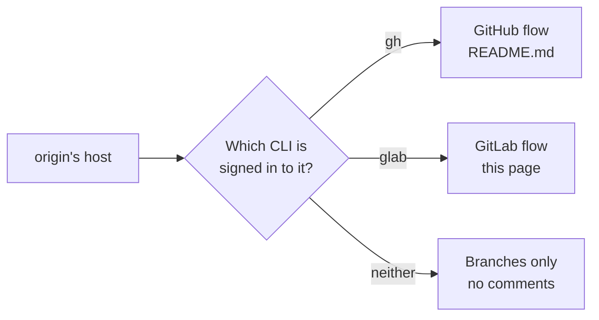

# GitLab merge requests

Status: **planned for 0.2.0**. The seam is in JetBrains 0.1.4: every host call goes through `ReviewHost`, picked as
below, and GitHub is the only host yet. When GitLab ships, the schema, a fixture and the [README](README.md)'s flow
table change in the same PR, as [CONTRIBUTING](../CONTRIBUTING.md) asks.

Same product, same flow, same `.git/review-lens/` files. Only the host calls change: `glab` instead of `gh`, merge
requests (MRs) instead of pull requests. Park, checkout, read-only, scope, "since your last review", Exit and the
[impact map](impact.md) are plain git and don't change at all.

Every wire fact below was measured on gitlab.com (GitLab 19.7, `glab` 1.131) on a private scratch
project and on public gitlab.org projects (read only), unless the line says it comes from GitLab's docs. One step is
not measured yet: approving an MR you didn't open (it needs a second account).



## Picking the host

What git already knows comes first; the host is asked only when git can't say.

1. Read `origin`'s URL and take its host, an SSH alias resolved to its `HostName` (as for GitHub). No remote: the
   panel says the project isn't on GitHub or GitLab yet, with one button, **Link a repository…**, that opens the IDE's
   own Manage Remotes (`Git.Configure.Remotes`); the panel picks up the new remote by itself. Not a Git repository: it
   says so, with no button (a repository made now has nothing to review).
2. **Over SSH, the greeting names both the host's kind and the account git connects as** (whose key it is, not what it may do): `ssh -T git@<host or alias>`, the same key
   git connects with. GitHub answers `Hi <login>! You've successfully authenticated, but GitHub does not provide shell
   access.` (measured: an SSH alias and plain `github.com` greeted two different accounts, one per key); GitLab answers
   `Welcome to GitLab, @<username>!` (GitLab's docs; not measured, as no key here is on gitlab.com). It runs with
   `BatchMode=yes`, stdin closed and a 5 s limit on the whole process (a `ConnectTimeout` alone doesn't stop a session
   that connects and then hangs), so a key behind a passphrase or a host that doesn't answer stays quiet. A deploy key
   greets as a repository (`Hi <owner>/<repo>!`, from GitHub's docs, not measured): a name with a `/` is no account.
   The answer is kept per host or alias, as the list picks again on every load and an SSH agent may ask to approve
   each use of a key.
3. **Over HTTPS, the account is a user written in the URL** (`https://<user>@github.com/…`) or `credential.<url>.username`.
   Git's saved sign-in is never read: `git credential fill` returns its password with the username (on this machine no
   `credential.*.username` is set, so an HTTPS remote names no account and push rights decide, step 5).
4. The kind, when git didn't say: `github.com` is GitHub and `gitlab.com` is GitLab, by name. Any other host is asked
   once, signed out, and the answer is kept for that host: `GET https://<host>/api/v4/version` answering JSON with a
   `message` or a `version` is GitLab (gitlab.com: **401** `{"message":"401 Unauthorized"}` in 0.56 s, measured;
   github.com: 404 plain text); `GET https://<host>/api/v3/meta` answering with an `X-GitHub-Request-Id` header is
   GitHub Enterprise (api.github.com/meta carries it, measured; an Enterprise server's answer is from GitHub's docs).
   No answer within 5 s, or any other answer: the token card asks which the server runs. You can change the kind there.
5. **The account Review Lens acts as** needs a token, as an SSH key can't call the API. Only accounts whose token can
   **see** the listed repository count (in a fork, the parent: README's [Forks](README.md#forks)), and "can push" is read
   on `origin`. Seeing means a read of the repository answers: an account without access gets **404**, measured with one account's token on another account's private repository; an organisation's single sign-on not authorised for the token answers 403 with an `X-GitHub-SSO` header, from GitHub's docs, not measured. In order: the account you
   picked for this repository; else the account git connects as; else, git saying nothing, the only account that can see
   it, or the only one that can push (the repository's `permissions.push`; on review-lens the owner's account `push=true`,
   a second account `push=false`, measured); else you pick once among those that can see it, remembered for this repository.
   - No token for git's account: the sign-in card names it ("Sign in to GitHub as vatsarishabh22", with the branch list below it, as with no token at all), offering
     "Review as <other> instead" only for an account that can see the repository.
   - git's account has a token that can't see the repository (an organisation's single sign-on not authorised for the
     token, an organisation that hasn't approved Review Lens, a missing scope): the card says so, with "Sign in again" or another account that can.
   - Tokens, none of which can see it: "None of your accounts can see <repo>".
   - A picked account that lost access is said once ("<account> can't see <repo> any more"), then the order goes on.
   - A sign-in or a pasted token that comes back as another account says so; its token is kept only if you choose to
     review as that account. Adding an account from the menu keeps the one you review as; switching is yours.
   - A company server's kind is saved with its token (the token card's choice), so a signed-in server is never asked.

A fork lists its parent's merge requests as in the README's [Forks](README.md#forks); GitLab names the parent
`forked_from_project` (GitLab's docs; no fork was measured on gitlab.com).

Self-managed GitLab works the same way: the host is whatever `origin` points at.

## Calling `glab`

- **Every call names the host and the project itself**: `glab api --hostname <host> projects/<group%2Fproject>/…`,
  and GraphQL `project(fullPath: "<group/project>")`, the path being the listed project's: `origin`'s URL, or in a
  fork its parent's (`forked_from_project`, or your pick; README's [Forks](README.md#forks)). `glab`'s own `:id` and
  `:fullpath` placeholders are never used: with an SSH alias in `origin` (`git@gitlab-personal:group/project.git`)
  they fail ("none of the git remotes configured for this repository point to a known GitLab host").
- **A write sends its payload as a JSON body** (`--input <file>`, `Content-Type: application/json`). `glab` 1.131
  refuses field names with brackets (`-f position[new_line]=…`).
- **A paginated GraphQL read** (`--paginate`, the query taking `$endCursor` and asking `pageInfo{hasNextPage endCursor}`)
  prints one JSON document per page, back to back (16 threads at one per page: 16 documents, as many as REST lists).
- **A GraphQL mutation can answer with an `errors` list and still exit 0**: a non-empty list is a refusal, said with
  its words.
- `--hostname`, `--input` and `--paginate` are in `glab api` since 1.12.0 (glab's own history).
- **A 429** ("rate limited by burst_traffic_per_user_free_plan, retry after *n*s", measured after about 30 calls at once)
  means GitLab didn't take the call: it waits `Retry-After` and is sent again, and the panel says it is waiting. Free
  allows 100 API calls a minute per user and 5,000 an hour (GitLab's docs), so every call goes one at a time; a Finish
  makes about 6 calls plus one per comment or reply.
- Time limits as in the README's rule 7: a read 30 s, a write 60 s. Measured: reads 1.3 to 3.6 s, writes 1.4 to 2.4 s.

## What's the same, what differs

| | GitHub | GitLab |
|---|---|---|
| Unit | Pull request `#<number>` | Merge request `!<iid>` |
| State key | `pr-<number>` | `mr-<iid>` |
| Head ref | `pull/<n>/head` | `refs/merge-requests/<iid>/head` |
| "Viewed" ticks | Synced with GitHub | **Local only.** GitLab keeps its "Viewed" checkboxes in the browser and has no API for them |
| "*k* files changed since your review" | GitHub's DISMISSED Viewed state | Your ticked files' blobs against the MR head's, read from GitLab (below) |
| One review | Pending review, then submit | Draft notes, then publish all |
| Approve | Review event `APPROVE` | Separate approve call |
| Request changes | Review event `REQUEST_CHANGES` | `reviewer_state` on publish |
| Undo a failed post | Delete the pending review | Delete the drafts, unapprove |
| A comment on several lines | `startLine` + `line` | `line_range`, anchored at its last line |
| Suggest a change | ` ```suggestion ` replaces the comment's lines | ` ```suggestion:-<n>+0 `: a plain block replaces only the last line (measured) |

## The flow

Every step not listed here is exactly as in the [README](README.md).

| Step | What happens | git / glab |
|---|---|---|
| List | Open MRs, the ones waiting on you first, [stacks](README.md#stacks) grouped. Three reads run alongside: the MRs, their commits, their counts (one query with all three took 4.8 to 6.4 s for 100 MRs; split, 2.9 to 3.6 s each). When the commits read fails the list shows no stacks; when the counts read fails it shows no counts. Waiting on you: you are among the MR's `reviewers` and your `reviewState` is `UNREVIEWED` (added, or asked again) or `REVIEW_STARTED` (a draft of yours exists); once you publish it is `REVIEWED`, `REQUESTED_CHANGES`, `APPROVED` or `UNAPPROVED`, as GitHub drops a request once you review. From a fork: `sourceProjectId != targetProjectId` (48 of 100 open MRs on `gitlab-org/cli`); its head ref sits in this project (3 of 3) and its threads are placed the same way | GraphQL `currentUser{username}`, `project(fullPath){mergeRequests(state:opened, first:100)}` with `iid title description updatedAt sourceBranch targetBranch diffHeadSha sourceProjectId targetProjectId author{username name} reviewers{nodes{username mergeRequestInteraction{reviewState}}}` · `commits(first:100){nodes{sha}}` (**newest first**: reversed to GitHub's oldest first) · `diffStatsSummary{additions deletions fileCount}` |
| Detail | Description, stats, the head on GitLab, the pipeline | `mergeRequest(iid){diffHeadSha headPipeline{status jobs(statuses:[FAILED, CANCELED], retried:false){count}}}` |
| Checks | The head pipeline's status, read with GitHub's rule (a cancelled check fails, one waiting on a person runs, a skipped one passes): `FAILED`, `CANCELED` → *n* failing, *n* the failed or cancelled jobs not retried, at least 1 (1 or 2 failed on 9 failed public MRs) · `CREATED`, `WAITING_FOR_RESOURCE`, `PREPARING`, `WAITING_FOR_CALLBACK`, `PENDING`, `RUNNING`, `SCHEDULED`, `CANCELING`, `MANUAL` → running · `SUCCESS`, `SKIPPED` → passed · no pipeline → nothing shown | Same query, `jobs(statuses:[FAILED, CANCELED], retried:false)` (`PipelineStatusEnum`, 13 values) |
| Fetch | The MR's head into a private ref, plus its target branch. GitLab deletes the head ref 14 days after an MR closes (GitLab's docs), so a fetch failing on a closed MR says so | `git fetch --no-tags origin +refs/merge-requests/<iid>/head:refs/review-lens/mr-<iid> +refs/heads/<target>:refs/remotes/origin/<target>`, then as in the README |
| Viewed | A tick is saved locally as in the README, with `unsent` always empty. Folder ticks are the same ticks. Nothing is sent, so "Sending…" never shows | None |
| Threads | Every diff discussion on the MR. GitLab moves a thread's line along with each push, as GitHub does (a thread on line 14 sat on line 17 after 3 lines were added above it); when its line itself changes, the thread stays on the older push. So one is placed under its line only when `position.diffRefs.headSha == range.to` and `newLine` is set (a thread on a removed line has none); the rest are listed, not placed. GraphQL's `DiffPosition` has no line range, so a thread on several lines shows at its last line (`startLine` unknown). `resolved` folds it. GitLab puts **system notes inside a thread** ("changed this line in version 3 of the diff"): they are left out | GraphQL `mergeRequest(iid){discussions{nodes{id resolvable resolved resolvedBy{username} notes{nodes{id system url body author{username} userPermissions{adminNote resolveNote} position{newPath newLine oldLine diffRefs{headSha}}}}}}}`, paginated, keeping discussions whose first note has a `position` |
| Resolve | Shown when the first note's `userPermissions.resolveNote`. Sent at once | `discussionToggleResolve(input:{id, resolve})`, `id` = the discussion's global id (1.6 to 2.4 s) |
| Edit / delete posted | Shown when the note's `userPermissions.adminNote` (false on 115 of 115 notes by others). Sent at once | `updateNote(input:{id, body})` / `destroyNote(input:{id})`, `id` = the note's global id |
| Finish | See below | |

`ReviewThread.id` is the discussion's global id (`gid://gitlab/Discussion/<sha>`) and `ThreadComment.id` the note's
(`gid://gitlab/DiffNote/<n>`), so `resolveThread`, `editComment` and `deleteComment` take one id each, as on GitHub.

### Files changed since your review

GitLab keeps no Viewed state, so the list's "🔄 *k* files changed since your review" comes from the blobs Review Lens
already saves. *k* = the files ticked at the version you last reviewed whose blob at the MR's head on GitLab is no
longer the ticked one (a file that is gone counts as changed). This is the same rule as the 🔄 badge, so a rebase or an
amend that leaves a file alone never counts it. Unlike GitHub, a file whose content was put back to the viewed one
counts as unchanged. The rest of the README's rule stands: "New commits" when nothing ticked changed but the MR now has
files outside your review.

GraphQL `project.repository.blobs(ref: <diffHeadSha>, paths: [<ticked paths>]){nodes{path oid}}` gives git's own blob
ids (equal to `git ls-tree`, 1.3 s for 3 paths; a path that isn't there is left out). One query takes at most 100 paths
(GitLab's complexity limit is 250, about 2 a path: 120 paths are refused; 100 of 100 came back); more ticks are asked
in further queries. It is asked for every moved MR with ticks at once, with the same 20 s limit, and a failed ask is
quiet.

### Stacks

As in the README: the exact fact reads the MR's `commits`, a stacked MR's own count comes from a compare, and a stack
the host's way is an MR whose `targetBranch` is another open MR's `sourceBranch` (from this project). An MR's own count
on its parent: `repository/compare?from=<parent head>&to=<head>`, the length of `diffs` (1.5 to 1.8 s). No cap up to
2,092 files (GitHub's: 300); the count is a little below git's because GitLab pairs more renames (82 more in 2,092).
`compare_timeout: true` means `diffs` may be cut short, so the count is left unknown.

### Finish review on GitLab

GitLab has no single call that posts comments and a verdict together, and its GraphQL has no mutation for drafts or
approvals, so Review Lens builds the review from REST steps it can undo.

**Before posting**

1. Re-read the discussions, as in the README, so a resolved or deleted thread is reported first.
2. Read your existing drafts: `projects/<p>/merge_requests/<iid>/draft_notes`. Publishing posts **every** draft you
   have on the MR, including ones written in GitLab's web page. If there are any, the Finish popup says
   `You have 2 unpublished comments from GitLab. They'll be posted too.` before Submit (the slot's `started`).
3. Read the diff versions: `projects/<p>/merge_requests/<iid>/versions`. A new comment can be placed only on a version
   whose `head_commit_sha` is `range.to`. When none matches (a scope on older commits), the comments wait for their
   scope: Submit says why (the slot's `held`), replies alone still post.
4. Read the newest note id on the MR (`…/notes?sort=desc&order_by=created_at&per_page=1`), kept for a Finish that
   can't tell what posted (below).

**Where a comment goes.** From the matching version: `base_sha`, `start_sha`, `head_sha`. A line the diff adds has
`new_line` only. A line the diff doesn't change needs `old_line` too, its number in the version's `base_sha` file,
worked out from `git diff <base_sha> <range.to> -- <path>`. Without `old_line`, GitLab takes the draft and then
publishing **skips it without a word**: it stays a draft, and the review posts by halves (measured). A draft on several
lines sits on its last line, with `line_range.start` and `.end`, each with `old_line`/`new_line` as above, `type` `new`
for an added line or null, and `line_code` `<sha1 of the path>_<old>_<new>`. A ` ```suggestion ` block in such a comment
is written `suggestion:-<line - startLine>+0`.

**A draft GitLab won't place is refused before anything posts.** Each new comment's create answer carries `line_code`
(a reply or a draft without a position answers null and posts fine, so only new comments are checked). It was null
for exactly the comments publishing then skipped: 8 position shapes measured, 3 skipped (an unchanged line
without `old_line`, twice, and a `head_sha` that is no version's head) and 5 placed (an added line, an unchanged line
with `old_line`, an older version, a line outside the diff, a removed line). A null `line_code` on a new comment stops the
Finish: the drafts this attempt made are deleted, nothing is published, and the reason says which comment GitLab
couldn't place.

**Posting, in order**

| # | Call | Payload |
|---|---|---|
| 1 | One draft per new comment | `POST projects/<p>/merge_requests/<iid>/draft_notes` `{note, position: {position_type: "text", base_sha, start_sha, head_sha, old_path, new_path, new_line, old_line?, line_range?}}` |
| 2 | One draft per reply | Same endpoint, `{note, in_reply_to_discussion_id}` (the discussion id without its `gid://` prefix) |
| 3 | Approve, only for the Approve verdict, and only when `…/approvals` doesn't already say `user_has_approved` (approving twice answers a bare **401**, measured) | `POST …/approve` `{sha: <range.to>}`. GitLab approves only the MR's latest push: any other `sha` answers **409** ("SHA does not match HEAD of source branch"), an older commit every time (measured). So Approve is greyed, with that reason, for a scope ending before the latest push (the slot's `denied`), and a push since loading answers 409 with nothing posted |
| 4 | Publish everything, with the summary | `POST …/draft_notes/bulk_publish` `{note: <summary>, reviewer_state}`. The summary lands as a plain comment (4 of 4 not resolvable), as GitLab's own "Submit review" sends it; a draft without a position would land as a resolvable thread, which can block merging on a project that requires every thread resolved |

| Verdict | Approve call | `reviewer_state` |
|---|---|---|
| Comment | No | `reviewed` (GitLab adds "left review comments") |
| Approve | Yes | `reviewed` (your state stays `APPROVED`, measured) |
| Request changes | No | `requested_changes` (GitLab adds "requested changes") |

An Approve with no summary and no comments is step 3 alone. A summary with no comments is step 4 with no drafts: it
posts and sets the state (measured). Publishing with no drafts and no summary posts nothing (measured), so a Comment
with neither is refused before Submit, as on GitHub. GitLab's docs: a reviewer who can't request changes gets
`reviewed` instead.

**If a step fails**, nothing is left behind:

- Steps 1–2: delete the drafts this attempt created (`DELETE …/draft_notes/<id>`).
- Step 3: same, then say GitLab refused the approval, with its status (the only refusal seen, a repeat approve, was a
  bare 401 with no reason text).
- Step 4: unapprove if step 3 ran (`POST …/unapprove`), then delete the drafts.

A refused call never lands, so its undo is safe. As in the README, nothing is marked sent and the review stays open. After step 4, drafts get `posted: true` and
`verdict` is stored in the same three words as on GitHub (`COMMENT`, `APPROVE`, `REQUEST_CHANGES`), so the list's
"✓ Reviewed · approved" works unchanged.

**A step stopped unanswered** (rule 7). A delete is no undo here: 30 drafts deleted while a publish ran all answered
204 and all 30 posted anyway (measured). So after a stopped call Review Lens never deletes; it proves what posted from
what GitLab holds.

| Stopped at | Then |
|---|---|
| A create or the publish (1–2, 4) | Can't tell: a stopped create still lands, with no id (7 of 7, each seen on the next read), and nothing is sent after it; a stopped publish landed whole every time (30 of 30 at each of 3 stops), and once its drafts were gone their notes were visible (0 of 10 gone without one) |
| Approve (3) | Its drafts were never published, so they are deleted; then unapprove (404 when it didn't land, measured); the attempt failed. An approve landing after the unapprove leaves the MR approved, the verdict you chose, and the next Finish skips step 3 |

**Can't tell** keeps every draft on GitLab and sets `uncertain`: the newest note id this Finish read before posting,
and the drafts it sent. GitLab keeps no link from a note back to its draft (none of a published note's fields names
it, measured), but note ids only grow (19 of 19), so "newer than that id" means "posted by this or a later call". The
next Finish is greyed, saying to open the merge request on GitLab, while you have any draft on the MR; this also waits
for a create that landed without an id. A held Finish's drafts can't be edited until it settles (rule 5), since an
edited one would no longer match. Once no draft is left, each sent draft settles once:

- **Posted** when GitLab holds a note of yours newer than the saved id with the same text on the same file (the same
  thread, for a reply), one note for each such draft: `posted: true`. Never by line: GitLab moves a note's line with
  each push (14 became 17, measured). Published late, or published by you on GitLab, it never posts twice.
- **Not posted** otherwise (you deleted it on GitLab): it stays a local draft, and the next Finish sends it.
- `verdict` is stored only when your `reviewState` or `user_has_approved` shows it.

A Finish with only a summary sends no draft, so nothing waits on GitLab: it is posted once a note of yours with the
summary's text, newer than the saved id, is seen; until then the held popup says to check the merge request and offers
**Not posted, send again**.

### Your own MR

On gitlab.com with no approval rules (Free, 0 approvals required, `merge_requests_author_approval` false), `…/approvals`
said `user_can_approve: false` and the author's approve still **succeeded** (measured). So no verdict is greyed in
advance for permissions on GitLab (Approve is still greyed for a scope ending before the latest push, step 3). An Approve GitLab refuses fails at step 3: the drafts are deleted and Review Lens says GitLab refused it, with its status.
Request changes on your own MR, as the author with no reviewers, only adds GitLab's "requested changes" note: the MR's
state doesn't change (`detailedMergeStatus` stayed `MERGEABLE`, the author's `reviewState` null). It isn't greyed:
GitLab takes it. As a reviewer of the MR, it sets your state to `REQUESTED_CHANGES` (measured). On Premium and Ultimate,
GitLab's docs say the author can't approve by default; that refusal comes at step 3, as above.

## State changes

| Where | Change |
|---|---|
| `target.key` | Pattern becomes `^(pr-[0-9]+\|mr-[0-9]+\|branch-[A-Za-z0-9._-]+)$` |
| `target.prNumber` | Holds the MR's `iid` when the key starts with `mr-` (renaming it `number` would break every saved file) |
| `<key>.json` `unsent` | Always empty for `mr-` keys |
| `drafts[].replyTo` | A GitLab discussion's global id for `mr-` keys |
| `<key>.json` `uncertain` | New, for both hosts (issue #19): a Finish that couldn't tell what reached the host. GitHub: the pending review's id. GitLab: the newest note id read before posting and the drafts sent. While set, the next Finish greys Submit with the reason (settle it on the host first). It clears once the host's read shows it settled, and settles the drafts as it does: GitHub, the review submitted holding what was sent → `posted: true`, the review gone → they stay drafts (one read of the review by its id, as Finish already does); GitLab, no draft of yours left on the MR, then each sent draft as above |
| Fixtures | Add `mr-5.json`, a GitLab review with a reply and a verdict |
| Cases | `cases/gitlab/`: the list answer, checks, a draft's create answer (`line_code` null refused), the suggestion header. Run only by a GitLab client, as `cases/github/` is |

## Open questions

- **A second account.** Approving an MR you didn't open.
- **Older self-managed GitLab.** Publishing with `note` and `reviewer_state` came in GitLab 19.2 (!237813). Below it,
  the summary posts as its own note and Request changes is hidden. Drafts open resolvable threads only since 18.6
  (!210553): what Finish does below 18.6 is still to be decided.
- **Merge request approval rules** (required approvers, code owners) aren't shown. An approval GitLab accepts but that
  doesn't satisfy a rule still says "approved" in the list.

## Sources

- [Draft Notes API](https://docs.gitlab.com/api/draft_notes): draft positions, `in_reply_to_discussion_id`,
  `bulk_publish` with `note` and `reviewer_state`
- [Merge request approvals API](https://docs.gitlab.com/api/merge_request_approvals): `approve` with `sha` (409 on
  mismatch), `unapprove`, `merge_requests_author_approval`
- [Merge requests API](https://docs.gitlab.com/api/merge_requests/): list filters, `reviewer_username`, `iid`, `sha`
- [Merge request troubleshooting](https://docs.gitlab.com/user/project/merge_requests/merge_request_troubleshooting/):
  `refs/merge-requests/:iid/head`, deleted 14 days after the MR is closed or merged
- [Merge request diff versions](https://docs.gitlab.com/user/project/merge_requests/versions): each push is a version
  with its own head, base and start commits
- [`glab api`](https://docs.gitlab.com/cli/api): `--hostname`, `--input`, `--paginate`, GraphQL
- [GitLab issue 451995](https://gitlab.com/gitlab-org/gitlab/-/issues/451995): request for a "Request changes" API, raised
  for an IntelliJ plugin
- [GitLab Workflow for VS Code, MR 3234](https://gitlab.com/gitlab-org/gitlab-vscode-extension/-/merge_requests/3234):
  no public API for GitLab's "Viewed" state, so it's kept locally
