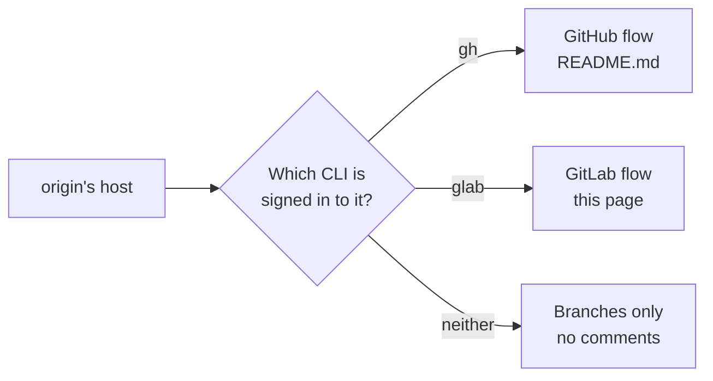

# GitLab merge requests

Status: **planned for 0.2.0**. The seam is in JetBrains 0.1.4: every host call goes through `ReviewHost`, picked as
below, and GitHub is the only host yet. When GitLab ships, the schema, a fixture and the [README](README.md)'s flow
table change in the same PR, as [CONTRIBUTING](../CONTRIBUTING.md) asks.

Same product, same flow, same `.git/review-lens/` files. Only the host calls change: `glab` instead of `gh`, merge
requests (MRs) instead of pull requests. Park, checkout, read-only, scope, "since your last review", Exit and the
[impact map](impact.md) are plain git and don't change at all.

## Picking the host

1. Read `origin`'s URL and take its host.
2. `gh auth status --hostname <host>` succeeds → GitHub. `glab auth status --hostname <host>` succeeds → GitLab.
3. Neither → the branch list, as today when `gh` is missing, saying which CLI to sign in with.

Self-managed GitLab works the same way: the host is whatever `origin` points at. `glab api` fills `:id` from the
checkout's remote, so no project ID is configured.

## What's the same, what differs

| | GitHub | GitLab |
|---|---|---|
| Unit | Pull request `#<number>` | Merge request `!<iid>` |
| State key | `pr-<number>` | `mr-<iid>` |
| Head ref | `pull/<n>/head` | `refs/merge-requests/<iid>/head` |
| "Viewed" ticks | Synced with GitHub | **Local only.** GitLab keeps its "Viewed" checkboxes in the browser and has no API for them |
| One review | Pending review, then submit | Draft notes, then publish all |
| Approve | Review event `APPROVE` | Separate approve call |
| Request changes | Review event `REQUEST_CHANGES` | Reviewer state on publish |
| Undo a failed post | Delete the pending review | Delete the drafts, unapprove |

## The flow

Every step not listed here is exactly as in the [README](README.md). Calls run through `glab api`, which handles
the host and the token; `<me>` is `username` from `glab api user`.

| Step | What happens | git / glab |
|---|---|---|
| List | Open MRs, the ones where you're a reviewer first | `glab api user` · `glab api "projects/:id/merge_requests?state=opened&per_page=100"` · `glab api "projects/:id/merge_requests?state=opened&reviewer_username=<me>&per_page=100"` |
| Detail | Description, stats, the head on GitLab (`sha`) and the diff SHAs | `glab api projects/:id/merge_requests/<iid>` (`sha`, `diff_refs.base_sha`, `diff_refs.start_sha`, `diff_refs.head_sha`) |
| Fetch | The MR's head into a private ref, plus its target branch. GitLab deletes the head ref 14 days after an MR closes, so a fetch failing on a closed MR says so | `git fetch --no-tags origin +refs/merge-requests/<iid>/head:refs/review-lens/mr-<iid> +refs/heads/<target>:refs/remotes/origin/<target>`, then as in the README |
| Viewed | A tick is saved locally as in the README, with `unsent` always empty. The change-since-viewed check (🔄) works unchanged, since it compares blobs | None |
| Threads | Every diff discussion on the MR. One is placed under its line only when `notes[0].position.head_sha == range.to` and `new_line` is set; the rest are listed, not placed. `resolved` folds it | `glab api --paginate projects/:id/merge_requests/<iid>/discussions`, keeping `notes[0].type == "DiffNote"` |
| Finish | See below | |

### Finish review on GitLab

GitLab has no single call that posts comments and a verdict together, so Review Lens builds it from steps it can undo.

**Before posting**

1. Re-read the discussions, as in the README, so a resolved or deleted thread is reported first.
2. Read your existing drafts: `glab api projects/:id/merge_requests/<iid>/draft_notes`. Publishing posts **every**
   draft you have on the MR, including ones written in GitLab's web page. If there are any, the Finish popup says
   `You have 2 unpublished comments from GitLab. They'll be posted too.` before Submit.
3. Read the diff versions: `glab api projects/:id/merge_requests/<iid>/versions`. A new comment can be placed only on
   a version whose `head_commit_sha` is `range.to`. When none matches (a scope on older commits), the comments wait for
   their scope, as the README's rule already says.

**Posting, in order**

| # | Call | Payload |
|---|---|---|
| 1 | One draft per new comment | `POST projects/:id/merge_requests/<iid>/draft_notes` with `note`, `position[position_type]=text`, `position[base_sha]`, `position[start_sha]`, `position[head_sha]` (from the matching version), `position[new_path]`, `position[old_path]`, `position[new_line]` |
| 2 | One draft per reply | Same endpoint, `note` and `in_reply_to_discussion_id` |
| 3 | Approve, only for the Approve verdict | `POST projects/:id/merge_requests/<iid>/approve` with `sha=<the MR head>`. A push since the review loaded makes GitLab answer 409, and nothing is posted |
| 4 | Publish everything, with the summary | `POST projects/:id/merge_requests/<iid>/draft_notes/bulk_publish` with `note` = the summary and `reviewer_state` |

| Verdict | Approve call | `reviewer_state` |
|---|---|---|
| Comment | No | `reviewed` |
| Approve | Yes | `reviewed` |
| Request changes | No | `requested_changes` |

A summary with no comments is sent as a draft without a position, so step 4 always has something to publish. An
Approve with no summary and no comments is step 3 alone.

**If a step fails**, nothing is left behind:

- Steps 1–2: delete the drafts this attempt created (`DELETE …/draft_notes/<id>`).
- Step 3: same, then show GitLab's reason.
- Step 4: unapprove if step 3 ran (`POST …/unapprove`), then delete the drafts.

As in the README, nothing is marked sent and the review stays open. After step 4, drafts get `posted: true` and
`verdict` is stored in the same three words as on GitHub (`COMMENT`, `APPROVE`, `REQUEST_CHANGES`), so the PR list's
"✓ Reviewed · approved" works unchanged.

### Your own MR

GitLab lets an author approve only when the project allows it (`merge_requests_author_approval`), and ignores
`reviewer_state` unless the author is also a reviewer. Read `user_can_approve` from
`glab api projects/:id/merge_requests/<iid>/approvals` and grey out the verdicts it rules out, with the reason, as the
README does for GitHub's own-PR rule.

## State changes

| Where | Change |
|---|---|
| `target.key` | Pattern becomes `^(pr-[0-9]+\|mr-[0-9]+\|branch-[A-Za-z0-9._-]+)$` |
| `target.prNumber` | Holds the MR's `iid` when the key starts with `mr-` (renaming it `number` would break every saved file) |
| `<key>.json` `unsent` | Always empty for `mr-` keys |
| `drafts[].replyTo` | A GitLab discussion id for `mr-` keys |
| Fixtures | Add `mr-5.json`, a GitLab review with a reply and a verdict |

## Open questions

- **Older self-managed GitLab.** `reviewer_state` on publish and the draft notes API are recent. The minimum GitLab
  version still needs checking against GitLab's changelog. Below it, fall back to publishing without `reviewer_state`
  and hide Request changes.
- **`glab` versions.** `glab api` with `:id` and `--paginate` is the only dependency. The minimum `glab` version is
  still to be confirmed.
- **Multi-line comments** (`position[line_range]`) stay out, as on GitHub today.
- **Merge request approval rules** (required approvers, code owners) aren't shown. An approval GitLab accepts but that
  doesn't satisfy a rule still says "approved" in the list.

## Sources

- [Draft Notes API](https://docs.gitlab.com/api/draft_notes): draft positions, `in_reply_to_discussion_id`,
  `bulk_publish` with `note` and `reviewer_state`
- [Merge request approvals API](https://docs.gitlab.com/api/merge_request_approvals): `approve` with `sha` (409 on
  mismatch), `unapprove`, `merge_requests_author_approval`
- [Merge requests API](https://docs.gitlab.com/api/merge_requests/): list filters, `reviewer_username`, `iid`, `sha`
- [Merge request troubleshooting](https://docs.gitlab.com/user/project/merge_requests/merge_request_troubleshooting/):
  `refs/merge-requests/:iid/head`, deleted 14 days after the MR is closed or merged
- [Merge request diff versions](https://docs.gitlab.com/user/project/merge_requests/versions): each push is a version
  with its own head, base and start commits
- [`glab api`](https://docs.gitlab.com/cli/api): `:id` placeholder, `--paginate`, GraphQL
- [`glab mr note draft publish`](https://docs.gitlab.com/cli/mr/note/draft/publish/): `--reviewer-state`, ignored for
  authors who aren't reviewers
- [GitLab issue 451995](https://gitlab.com/gitlab-org/gitlab/-/issues/451995): request for a "Request changes" API, raised
  for an IntelliJ plugin
- [GitLab Workflow for VS Code, MR 3234](https://gitlab.com/gitlab-org/gitlab-vscode-extension/-/merge_requests/3234):
  no public API for GitLab's "Viewed" state, so it's kept locally
- [python-gitlab discussions](https://python-gitlab.readthedocs.io/en/v3.1.0/gl_objects/discussions.html): diff note
  positions from the MR's diff SHAs
