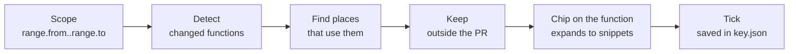

# Impact: who else depends on this change

Status: **proposed**, not built yet. When it ships, its state lands in [`state.schema.json`](state.schema.json) and
a fixture, like everything else in [the contract](README.md).

A diff shows the lines that changed. It doesn't show **who depends on them**. For each function the review's scope
changed, Review Lens shows the places that use it and that this PR didn't touch, as real code you can read and tick
off without leaving the file.



## Principles

These decide every case the tables below don't cover.

1. **A map, not a judge.** Show what is connected. Never say whether it is risky; the reviewer decides.
2. **Never invent.** A place is shown only when the IDE resolved it to this function. Missing a place is acceptable;
   showing a wrong one is not.
3. **Silence means checked.** No chip means the search finished and found nothing to check. It never means "couldn't
   tell".
4. **Stay where you are.** The impact comes to the function you're reading. No new tab, no new window.

## What counts as a change

Only functions and methods whose lines changed **in the current scope** (`range.from..range.to`). Picking "Since your
last review" maps only the new commits.

| Kind | How it's detected | Label | Places listed |
|---|---|---|---|
| Inputs changed | A changed line falls in the declaration's header: name, parameters, return type, decorators | `inputs changed` | References to it at `range.to` |
| Logic changed | Changed lines fall only in the body | `logic changed` | References to it at `range.to` |
| Removed | Declared at `range.from`, absent at `range.to` | `removed` | References at `range.to` that carry its name and no longer resolve to any declaration |

A function that is both is `inputs changed`. Not mapped in v1: **new** functions (most "no callers" there are framework
entry points, a false alarm), **renames and moves**, **class hierarchy** (overrides of a changed parent method).
**Comment-only and whitespace-only** changes are skipped: if every changed line in a function is a comment or
whitespace, it isn't mapped.

## Which places are shown

A **place** is the declaration (function, method, or the file's top level) that contains a reference. Places are split
into two groups, each listed and ticked the same way.

| Group | A place is in it when |
|---|---|
| Code | Its file is not a test file |
| Tests | Its file is under a test source root, or its name matches the language's test pattern (`test_*.py`, `*_test.py`, `*Test.kt`, `*.test.ts`, `*.spec.ts`, `*_test.go`) |

Then, in order:

1. **Import lines are dropped.** `from payments import calculate_refund` names the function without using it; the
   lines that call it are the places.
2. **Inside the PR is dropped.** A place whose file is in the scope's changed files is left out: the author touched it.
3. **Generated and vendored code is dropped** (the IDE's excluded and generated roots, `node_modules`, `vendor`).
4. **No places left → no chip.** This is the common case.
5. **More than 5 in a group → summary.** That group shows `Widely used: <n> places` with **Open Find Usages**, and its
   places are not on the checklist. Each group is counted on its own: 3 code places and 8 tests show the 3 code places
   and `Widely used: 8 tests`.

## What the reviewer sees

### The chip

On the function's declaration line, after the code:

```
def calculate_refund(order):   ○○○ 3 places use this · logic changed ⌄
```

- One dot per place on the checklist: hollow until ticked, filled after. The count includes a widely used group's
  places (3 code places and 8 tests: `11 places use this`); the dots and `n of m checked` count only the checklist.
- All ticked: `All 3 places checked`, dots filled, quieter colour.
- Clicking the chip, or the shortcut on the declaration line, folds or unfolds the peek.
- A **removed** function has no line left, so its chip sits in one strip above line 1 and starts with its name:
  `legacy removed · 1 place still uses it`, unfolding into the same peek. A deleted file has no tab: the strip sits
  above the base side of its diff.

### The peek

Unfolded under the declaration line, the same component as the comment cards:

```
Outside this PR · 1 of 3 checked                         ⌥I next place
Code
 ☑ admin.py:88  ↗
     amt = calculate_refund(o)
     send_sms(f"Rs {amt} refunded")
 ☐ invoice.py:41  ↗
     line.total = calculate_refund(o)
Tests
 ☐ test_refund.py:12  ↗
     assert calculate_refund(o) == 90
Calls made dynamically may not show
```

- Each place: path and line, then **the reference line and the line after it**, the reference highlighted.
- `↗` opens the place in the editor (read-only, it's the review checkout), with the reference selected.
- The last line appears **once per review**, in the first peek unfolded on a file in a language where the IDE can
  miss calls (Python, JavaScript, Ruby, PHP). After that it's assumed known and stays hidden.

### Words

Facts only. Never: *risky, unsafe, unused, untested, bug*.

| Situation | Text |
|---|---|
| Header changed | `inputs changed` |
| Body changed | `logic changed` |
| Removed, still referenced | `legacy removed · 2 places still use it` |
| Removed, all ticked | `legacy removed · all 2 places checked` |
| Chip | `3 places use this · logic changed` |
| All ticked | `All 3 places checked` |
| More than 5 | `Widely used: 14 places` |
| Dynamic languages | `Calls made dynamically may not show` |
| Searching | `Finding places…` |
| Too slow | `Many places · Open Find Usages` |
| Code the IDE can't analyse | `Impact not available for Go in this IDE` |

## Ticks

- **Manual only.** Opening a place doesn't tick it: opening isn't checking.
- **Next place:** ⌥I (Alt+I) moves to the next unticked place of the function under the caret, then of the next
  function in the file. (Alt+J is taken in both default keymaps: *Add Selection for Next Occurrence* on Windows and
  Linux, Jupyter's *Move cell down* on macOS; Alt+I is free in both.)
- **A function changed again un-ticks its places.** Each function's ticks are stored with a hash of its text at
  `range.to`. After a push or re-scope, a different hash clears that function's ticks; an unchanged one keeps them.
- **Local only.** Ticks live in `<key>.json` beside `reviewed`. GitHub has nowhere to keep them, and nothing is posted.

### The state

`<key>.json` gains one optional field:

```json
"checked": {
  "app/payments.py#calculate_refund": {
    "hash": "<sha1 of the function's text at range.to>",
    "places": ["app/admin.py#issue_refund", "tests/test_refund.py#test_floor"]
  }
}
```

- A function's key is `<path>#<qualified name>` (`Class.method` for a method), a place's is the same for the
  declaration holding the reference, or `<path>#<top level>` (those words, as written) outside any declaration. Names,
  not line numbers, so ticks survive lines moving.
- A removed function keeps its key from `range.from`.
- Entries for functions no longer in the scope are kept until the next Exit, so flipping scopes doesn't lose ticks.

## Timing and failure

| When | Chip |
|---|---|
| Review starts | The **open file's** functions are searched first, then the other changed files in the background |
| The IDE is indexing | `Finding places…`, greyed. Searches wait for indexing to finish |
| A search runs | `Finding places…` |
| A search passes ~3 s | Stopped. `Many places · Open Find Usages` |
| The file isn't code (YAML, JSON, SQL, Markdown: not in [`code-files.json`](code-files.json)) | Nothing: no functions, nothing missing |
| The file is code the IDE can't analyse (in `code-files.json`, no reader in this IDE) | One line above line 1: `Impact not available for <language> in this IDE`, the language named as `code-files.json` names it |
| A search throws | Nothing for that function, error logged. The review is never interrupted |
| A search finished with nothing to check | Nothing |

Results are cached per `range` and dropped when the range changes.

## Per editor

| Step | JetBrains | VS Code |
|---|---|---|
| Changed lines | The scope's diff, already computed for the gutter | Same |
| The declaration around a line | PSI: `PsiTreeUtil.getParentOfType(element, PsiNameIdentifierOwner)` | `vscode.executeDocumentSymbolProvider` |
| Header vs body | PSI: the declaration's range before its body block | Symbol `selectionRange` and range, plus the language's body start |
| References | `ReferencesSearch.search(declaration)` in a background read action, smart mode only | `vscode.executeReferenceProvider`; no provider means "can't analyse" |
| Removed function | Parse the `range.from` blob with `PsiFileFactory`; look for unresolved references by name at `range.to`. Python: a bare name only through a broken `from module import name` whose module resolves, a qualified one only on `self`/`cls` | Not in v1 |
| Test files | `ProjectFileIndex.isInTestSourceContent`, then the name patterns | Name patterns |
| Chip and peek | `EditorEmbeddedComponentManager`, like comment cards | Code lens for the chip, a peek view for the snippets |

## Decided

- **Inside the PR is by file** in v1: a place is dropped when its file is in the scope's changed files.
- **The next-place shortcut is ⌥I** (Alt+I).
- **JetBrains v1 languages:** Python, Java and Kotlin. Other code shows `Impact not available for <language> in this IDE`.
- **The reference search is proven** with the IntelliJ Platform test framework (real PSI fixtures per language), in CI.

## Open questions

- **Removed functions in VS Code**: without PSI there is no reliable "still references it". Ship without, or text
  search labelled as such?
